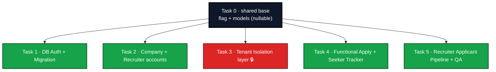

# Team Assignments — Multi-Tenant Recruiter Portal (5 Tasks)

> **Status:** Living tracker. Fill in owners, tick as work merges.
> Splits the spec into **5 tasks that can be built and merged independently
> without ever breaking the running app.**

---

## The golden rule: the app must always run

Each task is built so that **merging it does NOT change current behavior** until
everything is ready and we flip one switch. We achieve this with three rules:

1. **Add, never replace.** New tables, new routes, new **nullable** columns. The
   existing JSON + admin/candidate flow stays fully working the whole time.
2. **One feature flag** `MULTI_TENANT` in `config.py`, default **off**. All new
   multi-tenant behavior is gated behind it. Flag off ⇒ today's app, unchanged.
   Flag on ⇒ new flow. Only flipped at the very end (or per-dev locally for testing).
3. **Graceful fallback.** If a new piece isn't finished, the flag path for it is a
   no-op/placeholder; the app still boots and the old flow serves users.

```python
# config.py
MULTI_TENANT = os.getenv("MULTI_TENANT", "false").lower() == "true"
```

> Because of the flag + "add never replace", a half-finished feature can sit in
> `main` safely: it's dormant code nobody hits until `MULTI_TENANT=true`.

---

## Task 0 (shared, do FIRST, ~1 day, one person): data-model + flag + **Alembic** base

Before the 5 parallel tasks, **one short shared PR** so everyone builds on the same
foundation and nobody rewrites each other's models. This PR also sets up **Alembic**,
which from now on is the **only** way the database schema changes.

### 0a — Feature flag + models
- [ ] Add the `MULTI_TENANT` flag to `config.py` (default off).
- [ ] Add all new **nullable** columns / tables to `db/models_orm.py` in one go:
  `Company` table; `UserAccount.company_id` (nullable); `JobDescription.company_id`,
  `posted_by` (nullable); `Application` table (with unique `(jd_id, candidate_id)`).
- [ ] Add the new role names to `db/seed.py` (`platform_admin`, `recruiter`,
  `job_seeker`) **in addition to** existing ones (don't remove `candidate`/`admin` yet).
  _(Seeding ROLE ROWS lives here so Task 1's migration can reference them.)_

### 0b — Alembic setup (schema migrations) 🗄️
Goal: stop creating/altering tables with `create_all()`; every schema change becomes
a versioned, reviewed migration file in `alembic/versions/` committed to git.

- [ ] `pip install alembic` and add `alembic` to `requirements.txt`.
- [ ] From the repo root (`resume_jd_portal/`): `alembic init alembic`
  → creates `alembic.ini`, `alembic/env.py`, `alembic/versions/`.
- [ ] Wire `alembic/env.py` to the existing app (do NOT hardcode the URL):
  ```python
  from config import DATABASE_URL
  from db.database import Base
  from db import models_orm            # noqa: F401 — register all tables
  config.set_main_option("sqlalchemy.url", DATABASE_URL)
  target_metadata = Base.metadata      # enables --autogenerate
  ```
- [ ] Create the **baseline** migration capturing the schema that already exists
  (`model_registry`, `llm_call`, `request_trace`, `role`, `user_account`):
  ```
  alembic revision --autogenerate -m "baseline existing schema"
  ```
  Review the generated file, then on an existing DB mark it as already applied:
  ```
  alembic stamp head
  ```
- [ ] Create the **multi-tenant** migration for the new nullable columns/tables from 0a:
  ```
  alembic revision --autogenerate -m "add company, application, tenant columns"
  alembic upgrade head
  ```
- [ ] Change `db/database.init_db()` so it **no longer alters schema**: schema is
  owned by Alembic (`alembic upgrade head`). Keep `init_db()` only for a dev/test
  convenience path if needed (e.g. SQLite in tests), clearly commented as
  non-authoritative. `db/seed.py` still inserts **data** rows (models/roles) — that
  is data seeding, not schema, so it stays.
- [ ] Add a short `alembic/README.md` (or section in the main README) with the
  team workflow (see "Alembic workflow" below).
- [ ] Decide the test strategy: tests may keep using `create_all()` on in-memory
  SQLite for speed (document this), OR run `alembic upgrade head` against a temp DB.
  Pick one and write it down so everyone is consistent.

This PR changes **no behavior** (new nullable columns + dormant tables; same data).
After it merges, Tasks 1–5 run in parallel — and each of them ships its own Alembic
migration for any schema it adds.

### Alembic workflow (every DB change from now on)
```
# 1. edit db/models_orm.py (add a column/table)
# 2. generate a migration by diffing models vs DB:
alembic revision --autogenerate -m "describe the change"
# 3. REVIEW the generated file in alembic/versions/  (autogen isn't perfect)
# 4. apply it:
alembic upgrade head
# 5. commit the migration file with your code PR
# teammates then just run:  alembic upgrade head   (to catch up)
# to undo the last one locally:  alembic downgrade -1
```

> **Two different "migrations" — don't confuse them:**
> - **Schema migration (Alembic):** creates/changes tables & columns.
> - **Data migration (Task 1's `migrate_json_to_db.py`):** copies existing people
>   from JSON into the `user_account` rows. This is a one-time *data* move, separate
>   from Alembic (though it can be wrapped as an Alembic data migration if you want
>   it versioned too).

---

## The 5 tasks (parallel, each independently mergeable)



All five import from Task 0's models and check `MULTI_TENANT`. They touch mostly
**different files**, so they merge in any order without breaking `main`.

---

### Task 1 — DB-backed Auth + Migration · Owner: `________`
Build auth that can read/write `user_account`, behind the flag. Old JSON auth stays
the default.
- Covers: tasks **0.1–0.5** · requirements **R2.1, R8.1, R8.3**
- Flag behavior: `MULTI_TENANT=off` → current JSON auth runs (unchanged).
  `on` → DB-backed auth runs.
- Touches: `auth.py` (add DB path alongside JSON path), `scripts/migrate_json_to_db.py`, `tests/test_auth.py`
- Safe-merge check: with flag off, every existing login/register test still passes.
- Done when: flag on → register/login via DB works; migration proven on a JSON copy; flag off → nothing changed.

### Task 2 — Company + Recruiter Accounts · Owner: `________`
Company creation + recruiter invitations, as **new routes** under the flag.
- Covers: tasks **1.1–1.7** · requirements **R1.1, R2.2–R2.4, R9.1**
- Flag behavior: new routes (`/platform/company`, invite flow) only register/active
  when flag on; off → routes absent/hidden, old admin flow untouched.
- Touches: new `routes/platform_admin.py` (or guarded section), recruiter-invite logic, `auth.set_session` (add `company_id` only when present)
- Safe-merge check: flag off → app boots, no new nav, admin/candidate flow identical.
- Done when: flag on → platform admin creates a company + invites a recruiter who logs in with a company context.

### Task 3 — Tenant Isolation layer 🔒 · Owner: `________`
Build the reusable isolation helpers as a **standalone module** that does nothing
until a route opts in.
- Covers: tasks **2.1–2.8** · requirements **R3.1–R3.4, R4.1–R4.3, R9.3**
- Flag behavior: `tenancy.py` helpers (`@role_required`, `scoped_query`,
  `get_for_company`) are pure utilities — importing them changes nothing. Apply them
  to recruiter JD routes only inside `if MULTI_TENANT`.
- Touches: new `tenancy.py`, recruiter JD route guards (flag-gated), `observability/audit.py` (add `cross_tenant_denied` event)
- Safe-merge check: flag off → helpers unused, app identical. Ship the helpers +
  unit tests even before any route uses them.
- Done when: flag on → cross-tenant isolation test suite green for every recruiter route.
- ⚠️ Publish final helper signatures in the PR — Tasks 4 & 5 import them.

### Task 4 — Functional Apply + Seeker Tracker · Owner: `________`
Make the Apply button write an `Application`; add a tracker page. New endpoint,
new table (from Task 0), flag-gated.
- Covers: tasks **3.1–3.4** · requirements **R5.1–R5.4, R7.1**
- Flag behavior: Apply POST + tracker only wired when flag on. Off → button stays
  non-functional exactly as today (no regression).
- Touches: apply route + tracker template (in `routes/candidate.py` / later `jobseeker`), uses `Application` model, tests
- Safe-merge check: flag off → candidate pages identical to today.
- Done when: flag on → seeker applies, sees it tracked, row scoped to the JD's company; dup/no-resume/inactive handled.

### Task 5 — Recruiter Applicant Pipeline + QA · Owner: `________`
Recruiter views applicants, moves statuses, sees AI "Suggested"; owns the shared
isolation test harness + CI.
- Covers: tasks **4.1–4.8** + cross-cutting QA · requirements **R6.1–R6.4, R7.2, R7.3, R9.4, §5**
- Flag behavior: recruiter applicant pages flag-gated; QA tests run always (they set
  `MULTI_TENANT=on` inside the test to exercise the new flow).
- Touches: recruiter applicant routes/templates, status logic, reuse `pipeline/matcher.two_stage_match` for Suggested, resume-access gate, `tests/` (two-company isolation harness), CI (`.github/workflows/tests.yml`)
- Depends on (code import, not merge-order): Task 3's `tenancy.py`, Task 4's
  `Application` model — both come from Task 0 / early Task 3 PR, so you can start
  with stubs and wire the real import when they land.
- Done when: flag on → full Applied→Hired pipeline, seeker sees recruiter interest,
  resume gate denies non-applicants; CI blocks any PR that breaks isolation.

---

## Why this never breaks the running app

| Scenario | Result |
|---|---|
| Only Task 1 merged, rest not | Flag off → old JSON auth serves users; Task 1's DB path is dormant |
| Task 4 (apply) merged, Task 3 (isolation) not | Flag off → Apply still non-functional as today; no broken half-feature visible |
| All 5 merged, flag still off | App behaves exactly like today |
| All 5 merged, flag on | Full multi-tenant platform |
| A task is buggy | Keep flag off in prod; fix on a branch; prod unaffected |

**The switch:** flip `MULTI_TENANT=true` only after all 5 are merged + the QA
isolation suite is green. Flip per-developer locally anytime to test.

---

## Coordination rules
- **Task 0 merges first** (shared models + flag + Alembic). Everything else branches
  off it, and every teammate runs `alembic upgrade head` after pulling.
- **All schema changes go through Alembic — no exceptions.** Never add a table or
  column by editing the DB by hand or relying on `create_all()`. If your task adds
  schema, it **ships an Alembic migration file** in `alembic/versions/`, reviewed in
  your PR. (Which tasks add schema: 0, 1, 2, 4, and parts of 5.)
- **Branch per task**, small PRs, rebase on `main` often.
- **Migration conflicts:** if two tasks each generate a migration off the same
  parent, Alembic will have two "heads". Resolve by rebasing and running
  `alembic merge` (or regenerating yours on top of the other). Keep migrations small
  and merge them promptly to avoid long-lived divergent heads.
- Each PR must pass with **flag off** (proves no regression) — CI runs the suite
  flag-off by default; Task 5's new tests set flag-on internally.
- Don't remove any JSON/old-admin code until a final cleanup PR after the flag is on.

---

## Owner table (fill in)
| Task | Area | Owner | Branch | Flag-off safe? | Status |
|---|---|---|---|---|---|
| 0 | Shared base: flag + models | | | n/a | [ ] |
| 1 | DB auth + migration | | | [ ] | [ ] |
| 2 | Company + recruiter accounts | | | [ ] | [ ] |
| 3 | Tenant isolation 🔒 | | | [ ] | [ ] |
| 4 | Functional apply + tracker | | | [ ] | [ ] |
| 5 | Recruiter pipeline + QA | | | [ ] | [ ] |

> "Flag-off safe?" = confirmed that with `MULTI_TENANT=off` the app behaves exactly
> as before this task merged.
