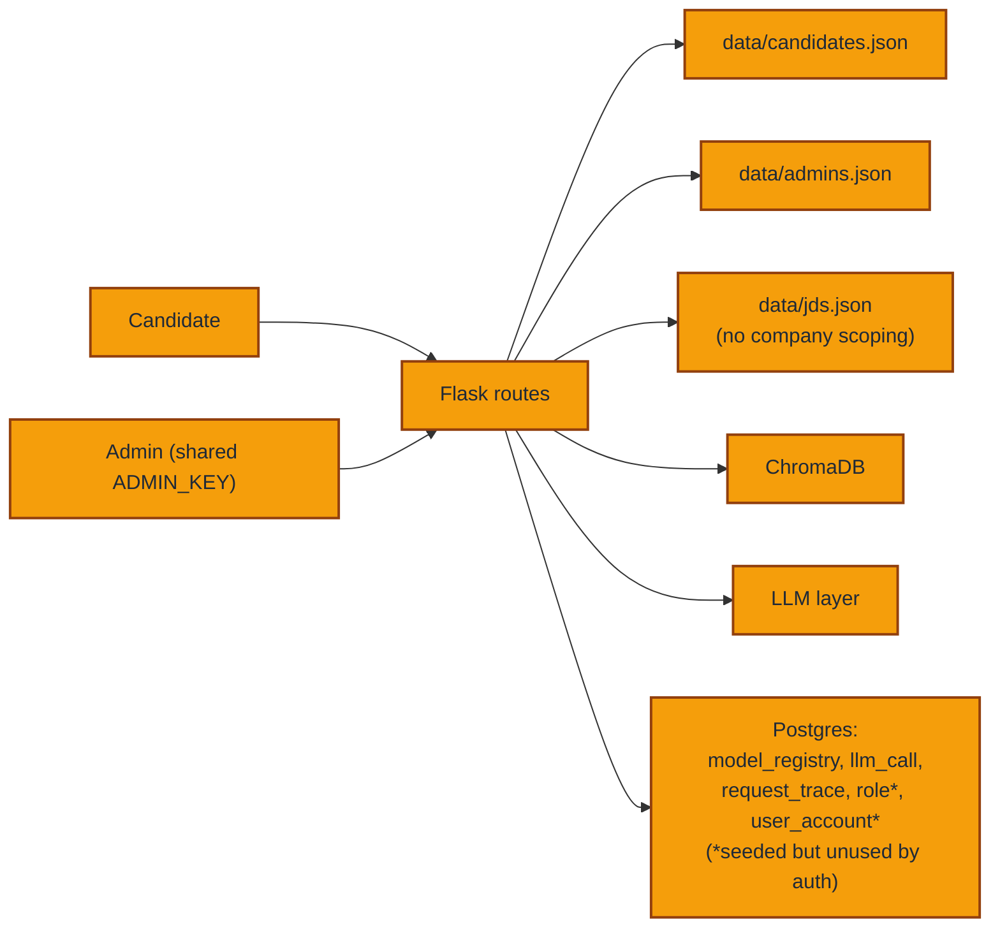
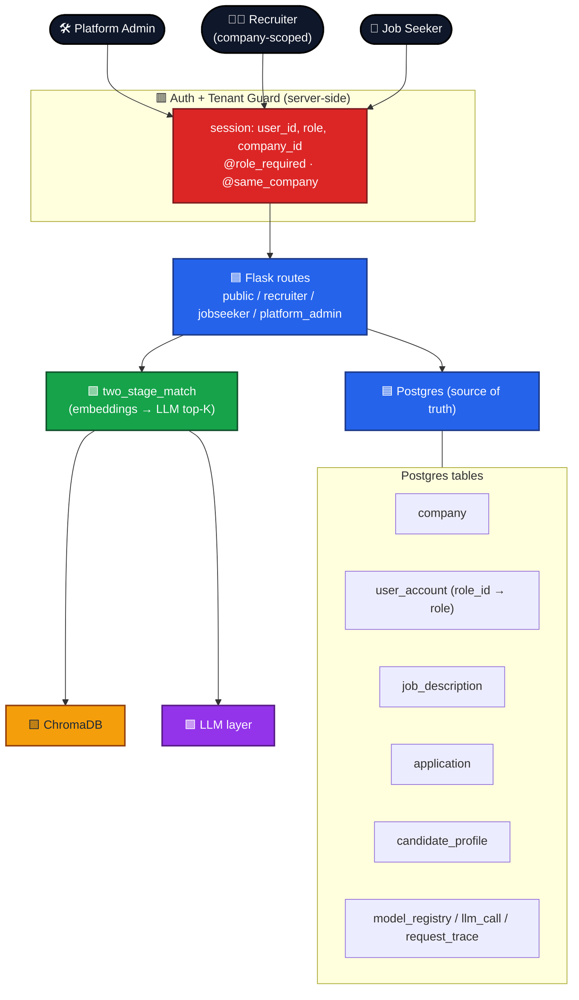
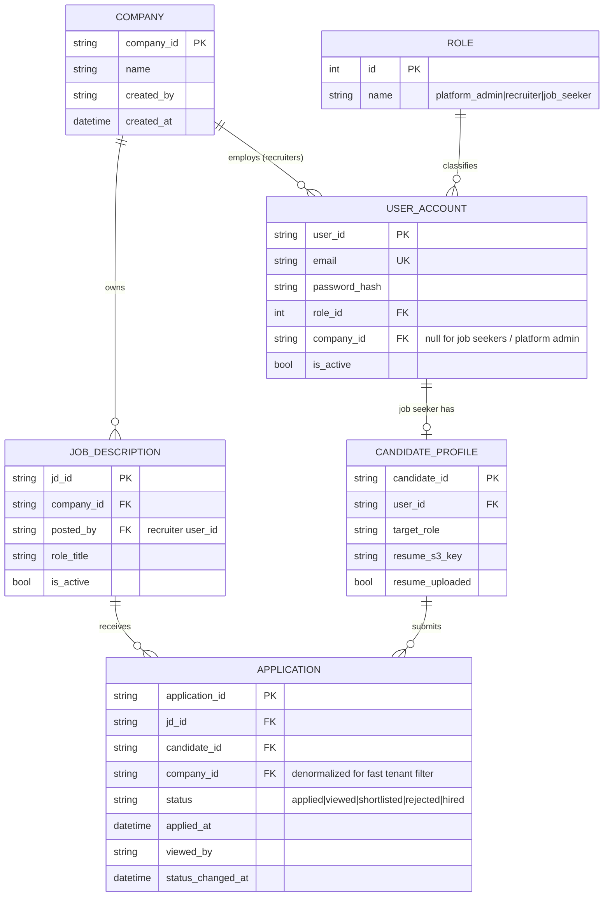
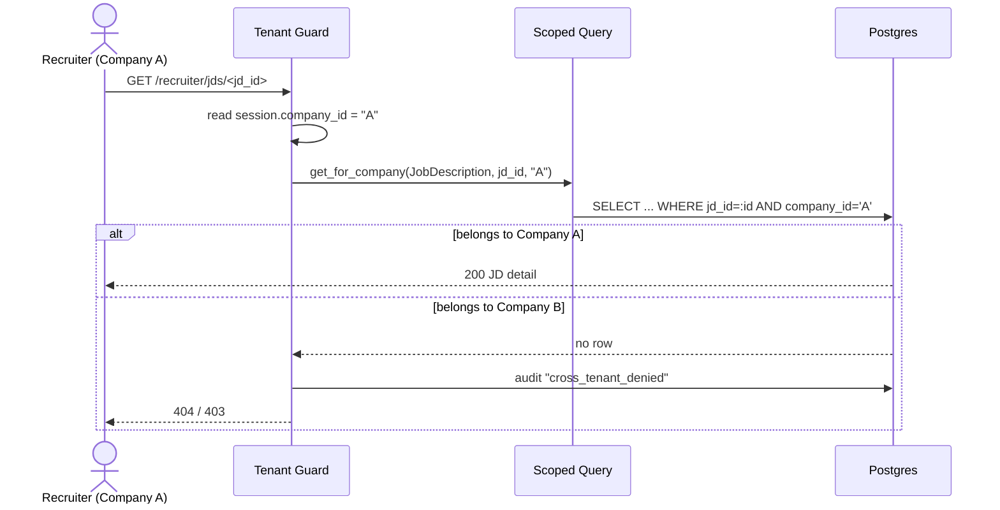
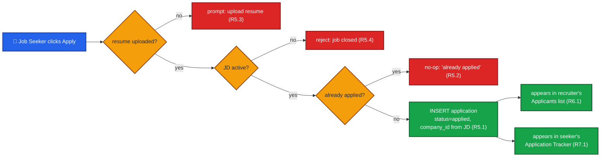
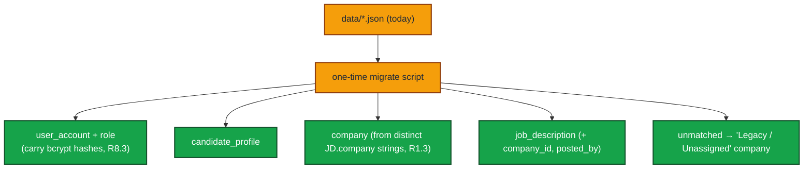

# Design — Multi-Tenant Recruiter Portal

> **Status:** Draft · living tracker
> Implements the requirements in `requirements.md` (IDs R1–R9 referenced throughout).

---

## 1. Design goals & constraints

- **Incremental, not big-bang.** Each phase ships and keeps the app runnable (R8.2).
- **Reuse what exists.** The DB already has `Role` + `UserAccount` and seeds a
  `recruiter` role (`db/seed.py`); the two-stage match funnel, embeddings, LLM
  layer, S3, and observability all stay. We add tenancy *around* them.
- **Server-side isolation.** Tenant checks live in route guards + queries, never in
  templates (R3.3).
- **No lost logins.** Candidate bcrypt hashes migrate as-is (R8.3).

---

## 2. Current vs target architecture

### Current (today)


### Target (multi-tenant)


---

## 3. Data model (target)

New/changed entities. Existing `model_registry` / `llm_call` / `request_trace`
stay unchanged. `Role` / `UserAccount` already exist and get *used* now.



### Why `company_id` is denormalized onto `APPLICATION`
Tenant filtering is the hottest query ("applications for my company"). Carrying
`company_id` on the application row (copied from the JD at apply time) makes the
isolation check a single indexed `WHERE company_id = :session_company` (R3.1)
without a join on every request.

### Mapping to existing code
| Target entity | Today | Change |
|---|---|---|
| `Company` | free-text `JobDescription.company` | new table; JD gains `company_id` FK |
| `UserAccount` + `Role` | `data/*.json` + `auth.py` | **start using** existing ORM tables |
| `CandidateProfile` | `models.Candidate` + `candidates.json` | move to DB table, link to `user_account` |
| `JobDescription` | `models.JobDescription` + `jds.json` | add `company_id`, `posted_by`; move to DB |
| `Application` | non-functional Apply button | **new** table |

---

## 4. Tenant isolation design (R3 — the heart of it)

Two layers, both server-side:

1. **Session context.** On login, store `role` and (for recruiters) `company_id`
   in the Flask session (extends `auth.set_session`).
2. **Guards + scoped queries.**
   - `@role_required("recruiter")` — gate recruiter routes.
   - `@same_company` / helper `scoped_query(model)` — every recruiter query is
     filtered by `company_id == session["company_id"]`.
   - Resource-by-id loads use a helper `get_for_company(model, id, company_id)`
     that returns 404 if the row's company doesn't match (R3.2), and logs the
     attempt to the audit trail (R9.3).



**Rule:** no recruiter route ever queries a model without going through the scoped
helper. Platform admin uses an unscoped path (R3.4).

---

## 5. Functional Apply design (R5, R6, R7)



### Applicant status pipeline (R6.2, R6.3)
```
applied ──(recruiter opens)──▶ viewed ──▶ shortlisted ──▶ hired
   │                                           │
   └───────────────▶ rejected ◀────────────────┘
```
Every transition writes `status_changed_at` + actor and an audit row (R9.3). When
status becomes `viewed`/`shortlisted`, the job seeker's tracker reflects it (R7.2).

### Suggested vs applied (R6.4)
The recruiter JD page shows **two sections**:
- **Applicants** — real `Application` rows (people who clicked Apply).
- **Suggested** — output of the existing `pipeline.matcher.two_stage_match` over the
  company's candidate pool, labeled "AI suggested", not applications.

---

## 6. Migration design (R8)

JSON → DB, in a reversible, phased way.



- Script is **idempotent** (safe to re-run) and **read-only on JSON** (keeps files
  as a backup until a phase explicitly removes them).
- Auth cutover: `auth.py` functions keep their signatures but switch their backing
  store from JSON to `user_account`, so routes don't change at cutover.

---

## 7. Routes (target blueprint layout)

| Blueprint | Prefix | For | Isolation |
|---|---|---|---|
| `public` | `/` | register (job seeker), login, logout | n/a |
| `jobseeker` | `/seeker` | dashboard, upload resume, browse, **apply**, tracker | own data only |
| `recruiter` | `/recruiter` | dashboard, post/manage JD, applicants, suggested, status | **company-scoped** |
| `platform_admin` | `/admin` | companies, users, models, metrics | cross-tenant |

The current `routes/candidate.py` becomes `jobseeker`; `routes/admin.py` splits:
company/JD/applicant management → `recruiter`; model-registry + platform ops →
`platform_admin`.

---

## 8. Security & observability deltas (R9)
- Replace shared `ADMIN_KEY` signup with **invite tokens** once invitations land
  (R9.1); keep `ADMIN_KEY` only for bootstrapping the first platform admin.
- Extend existing audit logger (`observability/audit.py`) with events:
  `cross_tenant_denied`, `application_created`, `application_status_changed`,
  `recruiter_viewed_candidate`.
- Resume access gate: a recruiter may fetch a candidate's resume **only** if that
  candidate has an `application` to one of the recruiter's company JDs (R9.4).
- Keep PII out of logs (reuse current trace/audit redaction) (R9.2).

---

## 9. Risks & mitigations
| Risk | Mitigation |
|---|---|
| Tenant leak via a missed route | Central `scoped_query` helper + a test that hits every recruiter route cross-tenant and expects 403/404 |
| Migration data loss | Idempotent script, JSON kept as backup, dry-run mode first |
| Big refactor destabilizes app | Phase gates in `tasks.md`; each phase independently shippable |
| Duplicate applications under race | DB unique constraint `(jd_id, candidate_id)` (R5.2) |

---

## 10. Traceability (requirement → design)
| Req | Design section |
|---|---|
| R1 Company | §3 data model, §6 migration |
| R2 Recruiter role/accounts | §3, §7 routes, §8 invites |
| R3 Isolation | §4 (guards + scoped queries) |
| R4 Job posting | §3, §7 |
| R5 Apply | §5 |
| R6 Applicant mgmt | §5 pipeline |
| R7 Seeker tracking | §5 |
| R8 Migration | §6 |
| R9 Security/audit | §8 |
