<div align="center">

# TalentLink

**AI-powered resume ↔ job description matching and candidate ranking platform.**

Semantic search narrows the field in milliseconds. A local LLM explains *why* the best candidates fit.

[](https://github.com/<your-github-username>/<your-repo-name>/actions/workflows/tests.yml)


[Live Demo](<your-demo-url>) · [Report a Bug](https://github.com/<your-github-username>/<your-repo-name>/issues) · [Request a Feature](https://github.com/<your-github-username>/<your-repo-name>/issues)

</div>

---

## Table of Contents

1. [Overview](#overview)
2. [Key Features](#key-features)
3. [System Architecture](#system-architecture)
4. [User Roles & Permissions](#user-roles--permissions)
5. [User Journeys](#user-journeys)
6. [How Matching Works](#how-matching-works)
7. [Resume & JD Processing](#resume--jd-processing)
8. [AI / LLM Layer](#ai--llm-layer)
9. [Data & Storage](#data--storage)
10. [Observability](#observability)
11. [Tech Stack](#tech-stack)
12. [Project Structure](#project-structure)
13. [Getting Started](#getting-started)
14. [Configuration Reference](#configuration-reference)
15. [Routes Reference](#routes-reference)
16. [Testing & CI](#testing--ci)
17. [Roadmap](#roadmap)
18. [Further Documentation](#further-documentation)
19. [Contributing](#contributing)

---

## Overview

**TalentLink** is a web platform that connects job seekers with the right roles and helps recruiters find the right people quickly, without reading every resume by hand.

Traditional applicant tracking relies on exact keyword matching: a resume that says *"built REST services on containers in the cloud"* can be missed by a job description asking for *"FastAPI, Docker, AWS"*. TalentLink fixes this by combining three techniques:

| Technique | What it does | Why it matters |
|---|---|---|
| **LLM parsing** | Reads the raw resume and extracts skills, years of experience, education and a summary | No hardcoded skill lists or regex. It understands context, date ranges and synonyms |
| **Semantic embeddings** | Turns resumes and JDs into vectors and measures how close they are in meaning | Catches conceptual matches that keyword search misses |
| **LLM reasoning** | Scores the shortlisted candidates and writes a verdict, strengths, gaps and reasoning | Recruiters see *why* a candidate fits, not just a number |

These are arranged as a **two-stage funnel**: cheap embedding and keyword scoring runs on *every* candidate, and the expensive LLM analysis runs only on the **top-K** shortlist. With 1,000 candidates and K = 10, that means 10 LLM calls instead of 1,000.

### Who it's for

| Role | Goal |
|---|---|
| 🧑‍💼 **Candidate** (job seeker) | Upload a resume once, then see which open roles fit best, with a score breakdown for each |
| 🧑‍💻 **Admin** (recruiter) | Post and manage job descriptions, then get every candidate ranked against a role with AI-written explanations |

### Design principles

- **Right tool for each job.** Embeddings narrow the field cheaply; LLMs do deep work only on the few that survive.
- **Local-first AI.** LLMs run on a local [Ollama](https://ollama.com) server, so resume data never leaves your infrastructure for inference.
- **Controlled model usage.** Every model has a lifecycle status (`active` / `inactive` / `retired`), and every request is status-checked and queued.
- **Observable by default.** Every request, pipeline stage and LLM call is traced and logged.

---

## Key Features

### 🧑‍💼 For Candidates

- **Account registration & login** with bcrypt-hashed passwords and a target role
- **Resume upload** in PDF or TXT format; re-uploading replaces the previous resume cleanly
- **AI resume parsing** that extracts skills, experience (in years), education and a profile summary
- **Personal dashboard & profile** showing everything the AI extracted from the resume
- **Job matching** that ranks every active job description against the candidate's resume
- **Multiple target roles**: enter several at registration (e.g. `Data Analyst, ML Engineer`) and switch between them with the *Target role* dropdown on Find Jobs; every job is re-scored for the chosen role
- **Editable target roles**: change, add or clear target roles any time from the Profile page (or *Edit roles* on Find Jobs); matching uses the new roles immediately
- **Detailed match view** per job: overall score, skill / semantic / experience / role breakdown, matched skills and missing skills

### 🧑‍💻 For Admins (Recruiters)

- **Admin registration** protected by a secret admin key
- **Admin dashboard** with an overview of all job descriptions, candidates and uploaded resumes
- **Job description management**: create, view, edit, deactivate and reactivate
  - Enter the JD as typed text **or** upload it as a PDF / DOCX file (text is extracted automatically)
  - Structured fields: role title, company, location, required skills, preferred skills, years of experience
  - Soft delete: deactivated JDs stay listed and can be reactivated at any time
- **Candidate list** of every registered candidate and their resume status
- **AI-ranked candidates per JD**: the two-stage funnel ranks everyone, and the top-K get an LLM verdict, score and reasoning
- **Model picker** to choose which LLM powers the analysis (speed vs quality) and change model status
- **Users & roles** page listing all candidate and admin accounts

### 🤖 AI & Matching

- **Two-stage matching funnel**: embeddings + keyword shortlist → LLM explanation on the top-K
- **Semantic similarity** using `all-MiniLM-L6-v2` sentence embeddings stored in **ChromaDB**
- **Hybrid scoring** that blends skills, semantic similarity, experience and role relevance, with automatic fallback weights when no embedding is available
- **Multiple local LLMs** via Ollama (Llama 3.2, Llama 3, DeepSeek R1), selectable from the UI
- **Model registry** with lifecycle status; inactive or retired models are rejected before any call is made
- **Request queue** that limits concurrent LLM calls and fails fast with a timeout instead of hanging

### ⚙️ Platform & Operations

- **Private cloud file storage** for original resumes and JD documents on **AWS S3**, one current document per candidate / JD
- **PostgreSQL** via SQLAlchemy for the model registry, LLM call logs, request traces and roles
- **Structured JSON logging** to rotating files, with sensitive fields (passwords, keys, tokens) redacted
- **End-to-end tracing**: one `trace_id` per request and one `span_id` per pipeline stage and LLM call
- **Automatic action auditing** for every state-changing request (who did what, where, when)
- **Optional AWS CloudWatch** log shipping, with PII redaction, behind a single flag
- **Optional AWS Secrets Manager** for configuration, falling back to environment variables
- **Offline test suite** (in-memory DB, faked LLM and vectors) running on **GitHub Actions** for every PR

---

## System Architecture

TalentLink is a server-rendered **Flask** application. Browsers talk to three route blueprints; the routes call into a service layer (parsing, matching, LLM); and the services persist to five kinds of storage. A cross-cutting observability layer wraps every request.

### High-level view

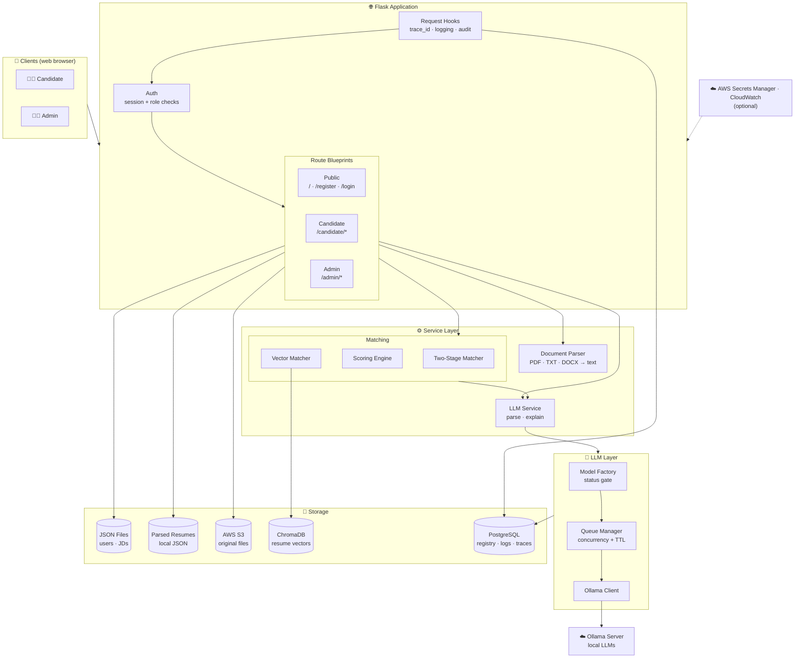

> Solid arrows are the main request path. Dotted arrows are optional integrations that are only active when configured.

### Components

| Layer | Component | Location | Responsibility |
|---|---|---|---|
| **Entry point** | App factory | `main.py` | Creates the Flask app, seeds the database, registers request hooks and blueprints |
| **Routes** | Public | `routes/public.py` | Landing page, registration, login, logout, role-based dashboard redirect, health check |
| | Candidate | `routes/candidate.py` | Dashboard, resume upload, profile, job matching, match detail |
| | Admin | `routes/admin.py` | Dashboard, JD CRUD + activate/deactivate, candidate list, ranked candidates, model picker, users |
| **Auth** | Auth module | `auth.py` | bcrypt password hashing, registration, login, session helpers, `login_required` / `candidate_required` / `admin_required` decorators |
| **Services** | Document parser | `resume_parser.py` | Extracts raw text only (PDF via pdfplumber, DOCX via python-docx, TXT). No skill rules |
| | LLM service | `llm/llm_service.py` | `parse_resume_smart`, `parse_jd_smart`, `explain_match`; validates JSON output and records every call |
| | Two-stage matcher | `pipeline/matcher.py` | Stage 1 scores all candidates; Stage 2 sends the top-K to the LLM |
| | Scoring engine | `matching_engine.py` | Skill, experience, role and weighted overall score |
| | Vector matcher | `vector_matcher.py` | Embeds resumes with `all-MiniLM-L6-v2`, stores them in ChromaDB, returns semantic similarity |
| **LLM layer** | Model factory | `llm/factory.py` | Resolves the requested model and rejects it unless its registry status is `active` |
| | Queue manager | `llm/queue_manager.py` | Bounded semaphore limiting concurrent LLM calls, with a timeout |
| | Ollama client | `llm/ollama_client.py` | Calls the Ollama `/api/generate` endpoint |
| | Prompts | `llm/prompts.py` | Prompt templates for resume parsing, JD parsing and match explanation |
| **Storage** | Database layer | `db/` | SQLAlchemy engine, ORM models and seed data |
| | S3 storage | `storage/s3.py` | Private upload / download with deterministic object keys |
| **Config** | Config loader | `config.py`, `config_loader.py`, `aws_secret_manager.py` | Resolves settings from AWS Secrets Manager → environment variables → defaults |
| **Observability** | Logging & tracing | `observability/` | JSON logs, trace/span IDs, request hooks, action auditing, CloudWatch handler |

### Request lifecycle

Every HTTP request follows the same path through the app:

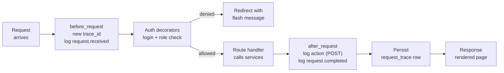

### Startup sequence

When the app starts (`python main.py`), `create_app()`:

1. Loads configuration (AWS Secrets Manager if configured, otherwise environment variables, otherwise defaults)
2. Creates the local data and log directories if they don't exist
3. Creates all database tables and seeds the **model registry** and **roles** (idempotent: safe to run every time)
4. Sets up JSON logging and registers the request tracing hooks
5. Registers the `public`, `candidate` and `admin` blueprints

---

## User Roles & Permissions

TalentLink has two active roles: **Candidate** and **Admin**. A user picks their role on the registration page; the role is stored in their session at login and checked on every protected page.

### What each role can do

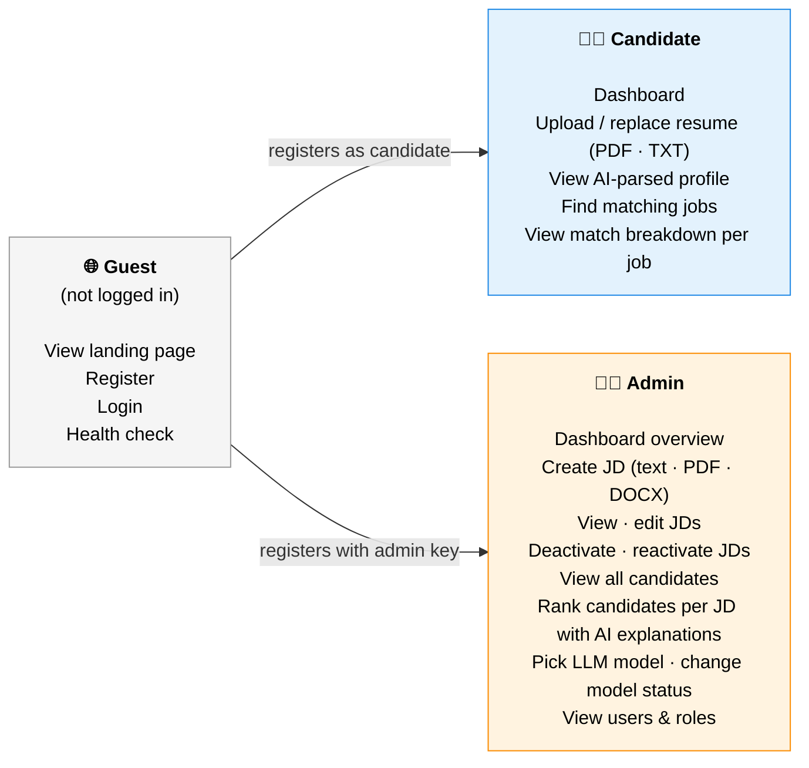

### Permission matrix

| Capability | Guest | Candidate | Admin |
|---|:---:|:---:|:---:|
| View landing page, register, login | ✅ | ✅ | ✅ |
| Upload / replace own resume | ❌ | ✅ | ❌ |
| View own parsed profile | ❌ | ✅ | ❌ |
| Match own resume against active JDs | ❌ | ✅ | ❌ |
| Create, edit, deactivate, reactivate JDs | ❌ | ❌ | ✅ |
| View all JDs (active + inactive) | ❌ | ❌ | ✅ |
| View all candidates | ❌ | ❌ | ✅ |
| Rank candidates for a JD (AI-assisted) | ❌ | ❌ | ✅ |
| Select LLM model / change model status | ❌ | ❌ | ✅ |
| View users & roles | ❌ | ❌ | ✅ |

### Registration

Both roles register through the same form. Choosing **Candidate** shows a *target role* field (e.g. "Python Developer"), used later for role-relevance scoring. Choosing **Admin** shows an *admin key* field instead.

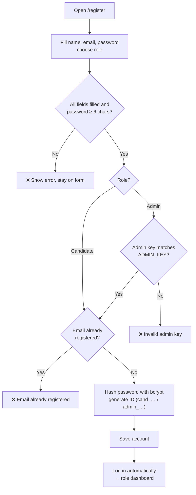

- Passwords are hashed with **bcrypt** (salted) and never stored in plain text.
- Emails are unique across both candidates and admins.
- The admin key is a shared secret set through the `ADMIN_KEY` setting (see [Configuration Reference](#configuration-reference)). Anyone without it can only register as a candidate.

### How access is enforced

Protected pages are wrapped in decorators from `auth.py`. Each request passes through them in order:

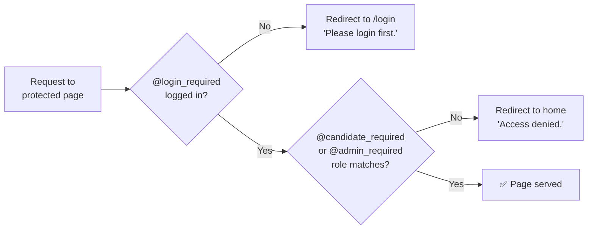

| Decorator | Applied to | Check |
|---|---|---|
| `@login_required` | Every candidate and admin page | A `user_id` exists in the session |
| `@candidate_required` | All `/candidate/*` pages | Session role is `candidate` |
| `@admin_required` | All `/admin/*` pages | Session role is `admin` |

After login, `/dashboard` sends each user to the right place automatically: admins to `/admin/dashboard`, candidates to `/candidate/dashboard`. The navigation bar also changes by role.

### Role definitions in the database

On startup, TalentLink seeds a `role` table with permission sets. This prepares the platform for finer-grained access control:

| Role | Permissions | Status |
|---|---|---|
| `admin` | `*` (everything) | Active |
| `candidate` | `upload_resume`, `match_jobs`, `view_profile` | Active |
| `recruiter` | `view_jds`, `view_candidates`, `rank_candidates` | Reserved for a future release (see [Roadmap](#roadmap)) |

---

## User Journeys

This section walks through every main flow in TalentLink, step by step, showing exactly which component does what.

### Journey map

The big picture: candidates and admins work independently, and the matching engine connects them.

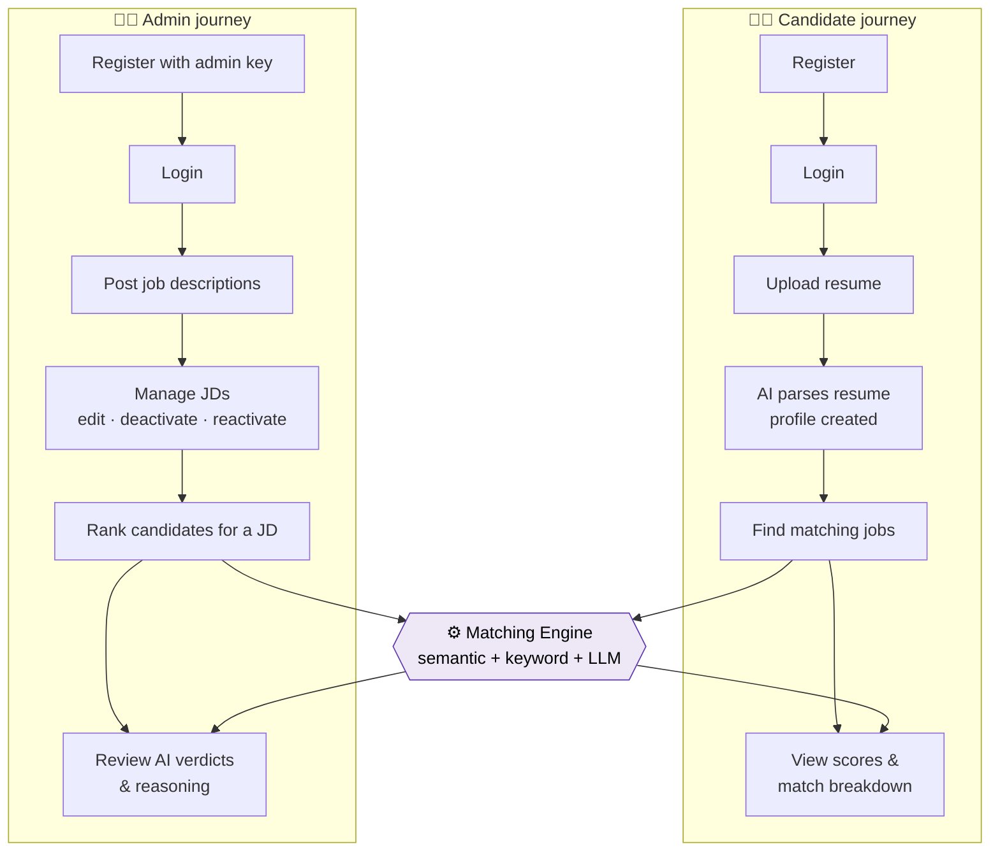

---

### 1. Login & session

TalentLink uses **server-side session cookies** (Flask sessions). After a successful login the session holds the user's ID, name and role, and every protected page reads it.

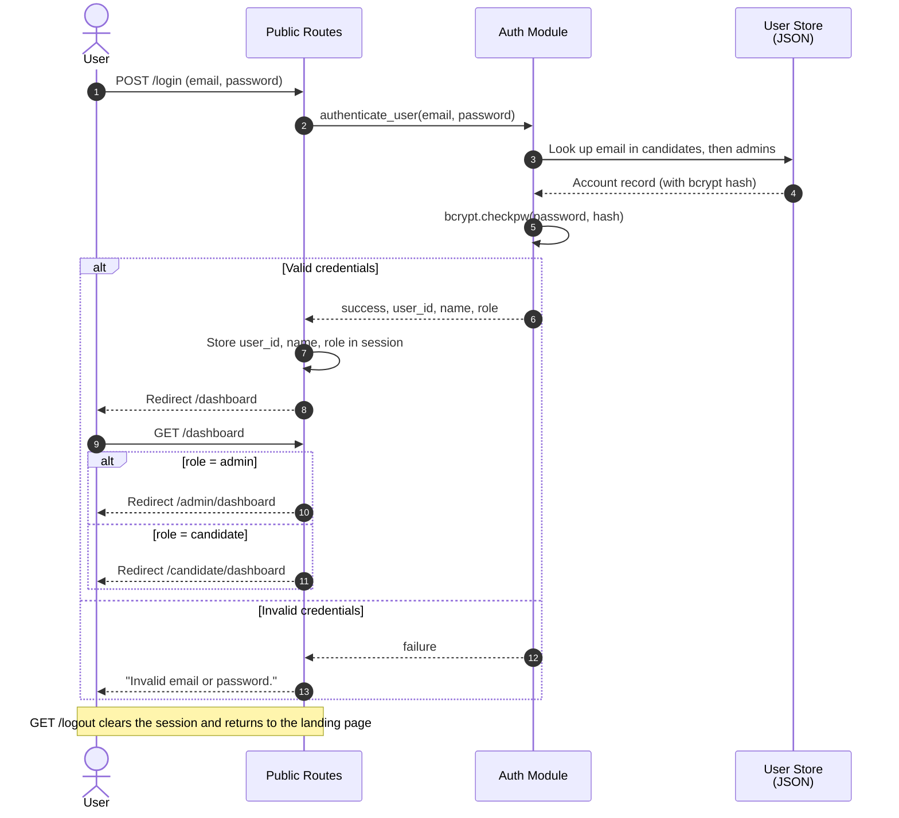

---

### 2. Candidate: resume upload & parsing

A candidate uploads a PDF or TXT resume. It is stored privately in S3, read back, converted to text, parsed by the LLM, saved as a structured profile and embedded for semantic search.

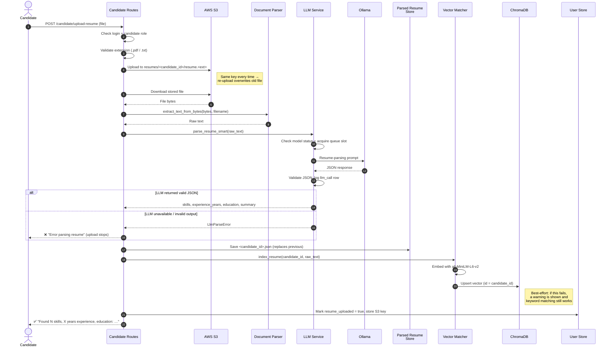

**What the candidate gets back:** a profile with an extracted skill list, total years of experience, highest education and a short AI-written summary, visible on the dashboard and the profile page.

---

### 3. Admin: job description upload

An admin creates a JD by filling in structured fields and **either** pasting the description text **or** uploading a PDF / DOCX file.

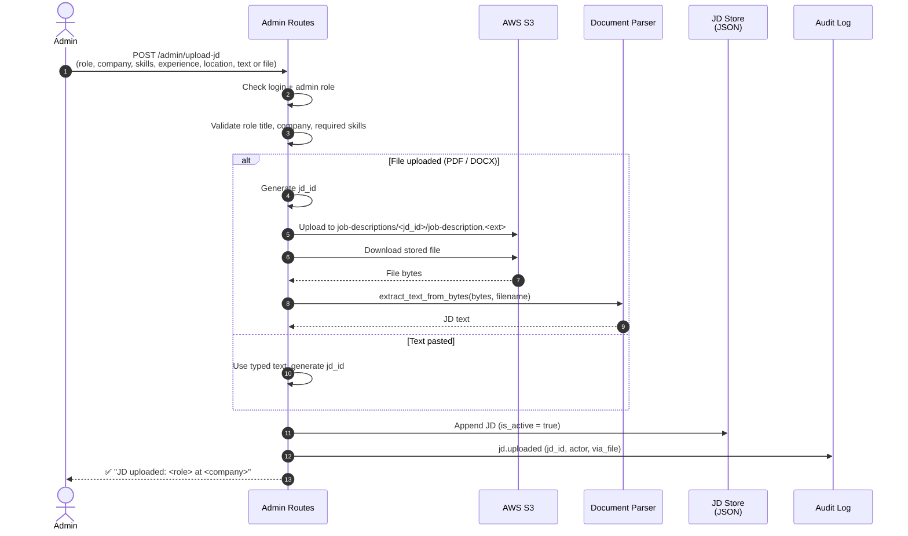

### 4. Admin: job description lifecycle

JDs are never hard-deleted. "Delete" is a **soft delete** that deactivates the JD, and it can be brought back at any time.

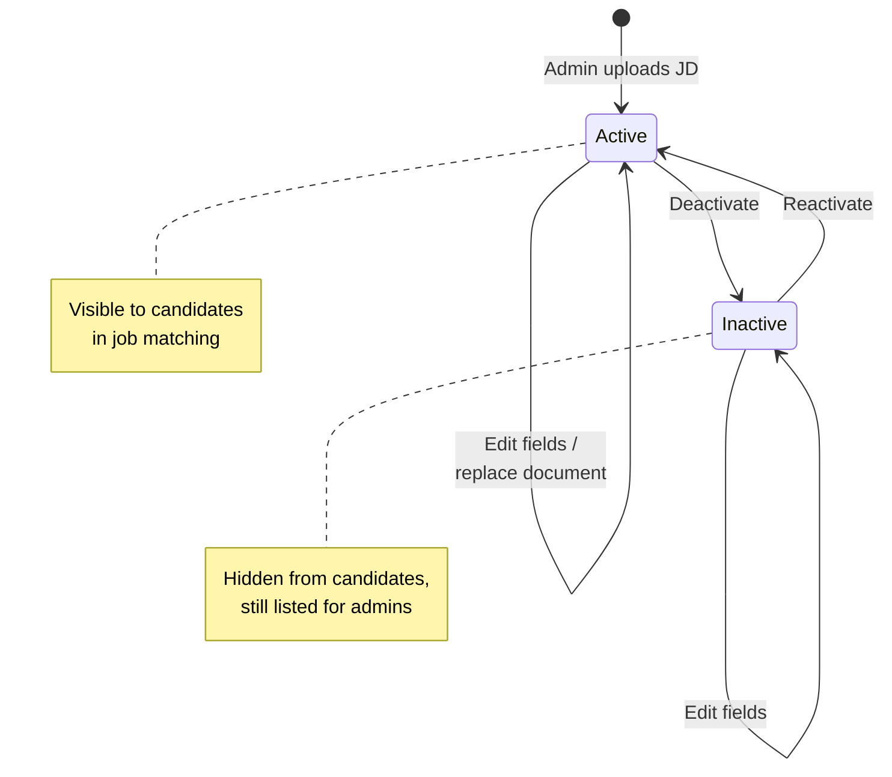

| Action | Route | Effect | Audit event |
|---|---|---|---|
| Create | `POST /admin/upload-jd` | New JD, `is_active = true` | `jd.uploaded` |
| Edit | `POST /admin/jds/<jd_id>/edit` | Updates fields; an optional new file overwrites the same S3 key and replaces the JD text | `jd.edited` |
| Deactivate | `POST /admin/jds/<jd_id>/delete` | `is_active = false` | `jd.deactivated` |
| Reactivate | `POST /admin/jds/<jd_id>/reactivate` | `is_active = true` | `jd.reactivated` |

---

### 5. Candidate: finding matching jobs

When a candidate opens **Find Jobs**, their resume is scored against **every active JD** and the results are sorted best-first. This view uses the fast scoring stage only (semantic + keyword), so it returns quickly.

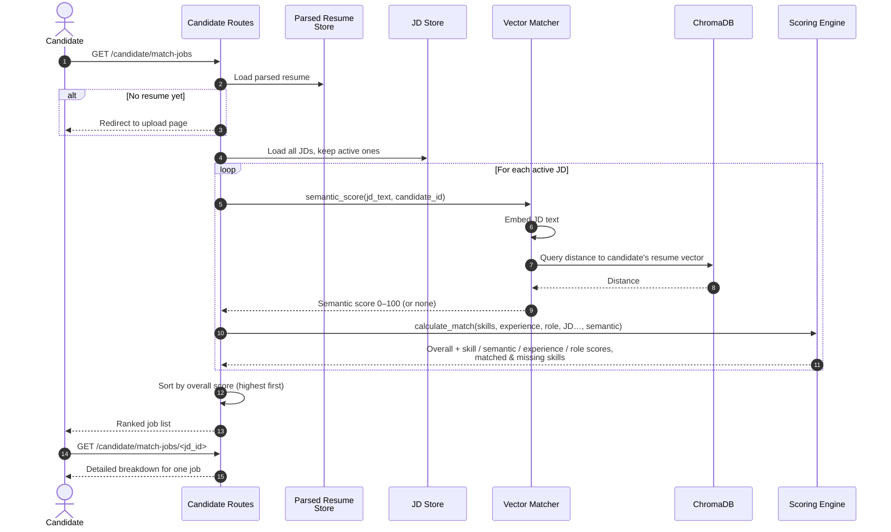

---

### 6. Admin: ranking candidates for a job

This is where the full **two-stage funnel** runs. Every candidate is scored cheaply, then only the top-K get a deep LLM analysis.

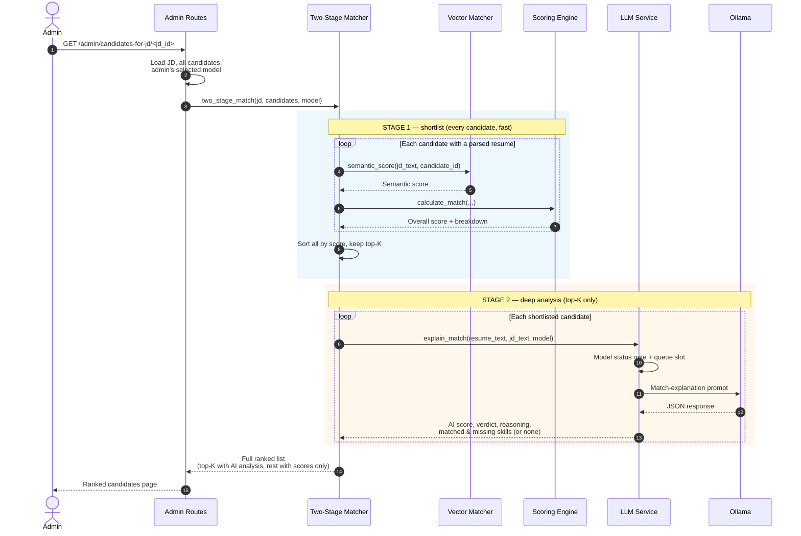

**What the admin sees:** every candidate ranked by score. The top-K also carry an **AI score**, a **verdict**, a written **reasoning**, and the **matched / missing skills** according to the LLM. If the LLM is unavailable for a candidate, that row simply keeps its Stage 1 scores.

---

## How Matching Works

Matching is the heart of TalentLink. It answers two questions:

- **Candidate view:** *"Which open jobs fit my resume best?"*
- **Admin view:** *"Which candidates fit this job best, and why?"*

Both use the same scoring engine. The admin view adds a second, AI-powered stage on top.

### The two-stage funnel

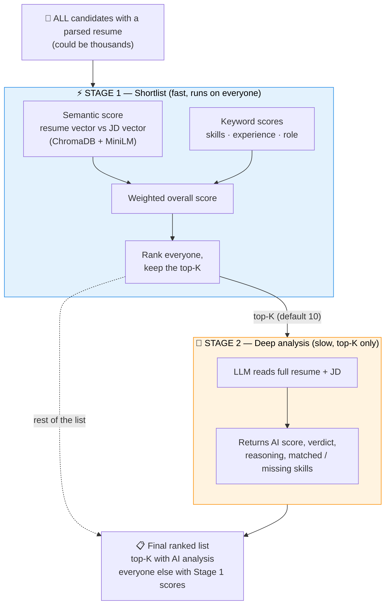

**Why two stages?** Embedding comparisons cost milliseconds and almost nothing. LLM calls take seconds each. Running the LLM only on the shortlist keeps ranking fast and cheap, with almost no loss in quality, because Stage 1 has already removed the obviously irrelevant candidates.

| | Stage 1 | Stage 2 |
|---|---|---|
| **Runs on** | Every candidate with a parsed resume | Top-K only (`MATCH_TOP_K`, default **10**) |
| **Technique** | Embeddings + keyword scoring | Local LLM via Ollama |
| **Speed** | Milliseconds per candidate | Seconds per candidate |
| **Output** | Overall score + 4 sub-scores, matched / missing skills | AI score, verdict, reasoning, matched / missing skills |
| **Used in** | Candidate job matching **and** admin ranking | Admin ranking only |
| **If it fails** | Semantic part falls back to keyword-only weights | Candidate keeps Stage 1 scores |

**Example cost saving:** 1,000 candidates with K = 10 → **10** LLM calls instead of 1,000 (a 100× reduction).

---

### Stage 1: the scoring engine

For every resume–JD pair, four sub-scores (each 0–100) are calculated and combined into one weighted **overall score**.

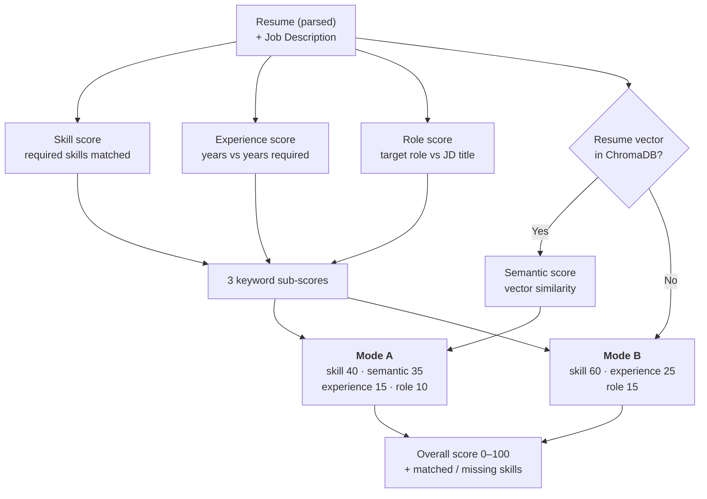

#### Weighting modes

The engine picks its weights automatically depending on whether a semantic score is available.

<table>
<tr>
<td width="50%" valign="top">

**Mode A: semantic available** (default)

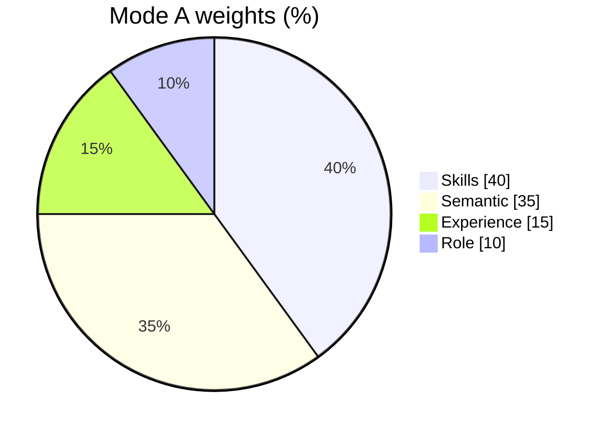

</td>
<td width="50%" valign="top">

**Mode B: keyword only** (fallback)

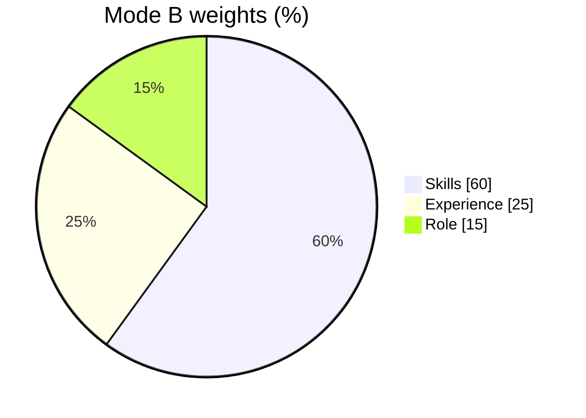

</td>
</tr>
</table>

| Mode | When it's used | Formula |
|---|---|---|
| **A** | The candidate's resume is indexed in ChromaDB and the JD has text | `overall = skill × 0.40 + semantic × 0.35 + experience × 0.15 + role × 0.10` |
| **B** | No resume vector exists yet (e.g. embedding failed) or the JD text is empty | `overall = skill × 0.60 + experience × 0.25 + role × 0.15` |

#### How each sub-score is calculated

| Sub-score | Calculation | Special cases |
|---|---|---|
| **Skill** | `matched required skills ÷ total required skills × 100` (case-insensitive) | **+5 bonus** if the candidate has *any* preferred skill (capped at 100). No required skills → 100 |
| **Semantic** | `1 ÷ (1 + distance) × 100`, where *distance* is between the resume vector and the JD vector in ChromaDB | Identical meaning → close to 100; unrelated → close to 0. Missing vector → no score (Mode B) |
| **Experience** | `candidate years ÷ required years × 100`, capped at 100 | Meets or exceeds requirement → 100. No requirement → 100 |
| **Role** | Word overlap between the candidate's target role and the JD title, after normalising both with `role_titles.py`: punctuation is handled (*AI/ML* → *ai ml*, *Sr.* → *sr*, *Node.js* stays one word) and synonyms / abbreviations are mapped to one form (*Machine Learning* → *ml*, *Sr* → *senior*, *Full-Stack* → *fullstack*). Filler words (*a, the, of, and…*) are ignored | Same words → 100. Some overlap → `50 + (overlap ÷ all words) × 50`. No overlap or missing → 20. Add new synonyms to `SYNONYMS` in `role_titles.py`. **Several target roles** (typed at registration, separated by `,` `;` `\|` or "or"; `/` does not split) are scored one at a time: Find Jobs uses the role picked in its *Target role* dropdown (first role by default); admin ranking uses the candidate's best role and names it on the card (*Best role match: ML Engineer*; tied roles are all listed) |

#### Semantic matching details

| Property | Value |
|---|---|
| Embedding model | `all-MiniLM-L6-v2` (sentence-transformers, 384 dimensions) |
| Vector store | ChromaDB persistent client at `data/chroma/`, collection `resumes` |
| Resume document ID | The candidate's ID, so re-uploading **replaces** the vector (no duplicates) |
| JD embedding | Created on the fly each time a match is calculated |
| Model loading | Lazy: loaded once on first use, then cached in memory |

**Why it matters:** a resume that says *"built REST services on containers in the cloud"* shares no keywords with a JD asking for *"FastAPI, Docker, AWS"*, but their vectors are close, so the semantic score still rewards the match.

---

### Worked example

**Candidate**

| Field | Value |
|---|---|
| Target role | Python Developer |
| Skills (from AI parsing) | Python, Flask, Docker, SQL, AWS |
| Experience | 3 years |

**Job description**

| Field | Value |
|---|---|
| Role title | Python Backend Developer |
| Required skills | Python, Flask, PostgreSQL, Docker |
| Preferred skills | AWS, Redis |
| Experience required | 4 years |
| Vector distance to resume | 0.38 |

**Step-by-step scoring**

| Sub-score | Working | Result |
|---|---|---|
| Skill | 3 of 4 required matched (Python, Flask, Docker) → 75; has preferred skill AWS → +5 | **80.0** |
| Semantic | 1 ÷ (1 + 0.38) × 100 | **72.5** |
| Experience | 3 ÷ 4 × 100 | **75.0** |
| Role | Overlap {python, developer} of {python, backend, developer} → 50 + (2 ÷ 3) × 50 | **83.3** |

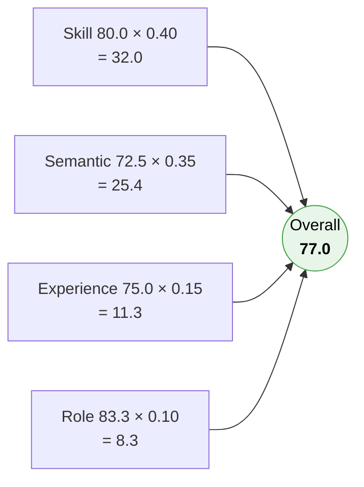

**Result:** overall score **77.0** (Mode A). Matched skills: *Python, Flask, Docker*. Missing: *PostgreSQL*.
Without a resume vector (Mode B) the same pair would score 80 × 0.6 + 75 × 0.25 + 83.3 × 0.15 = **79.2**.

#### Score bands in the UI

| Score | Badge | Meaning |
|---|---|---|
| **75 – 100** | 🟢 High | Strong fit |
| **50 – 74** | 🟡 Mid | Partial fit, worth a look |
| **0 – 49** | 🔴 Low | Weak fit |

---

### Stage 2: AI match analysis

For each shortlisted candidate, the LLM receives the **full resume text** and the **full JD text** and acts as a senior hiring manager. It must reply with strict JSON:

```json
{
  "overall_score": 82,
  "matched_skills": ["Python", "Flask", "Docker"],
  "missing_skills": ["PostgreSQL"],
  "verdict": "Strong Match",
  "reasoning": "The candidate has solid backend experience with Python and Flask ..."
}
```

| Field | Description |
|---|---|
| `overall_score` | The LLM's own 0–100 fit score, shown next to the Stage 1 score |
| `verdict` | One of **Strong Match**, **Partial Match** or **Weak Match** |
| `reasoning` | A 3–4 sentence explanation of the fit |
| `matched_skills` / `missing_skills` | Skills the LLM judged present or missing, including synonyms keyword matching can't see |

The list stays ordered by the Stage 1 overall score. The AI assessment is added as an explanation on each of the top-K cards. If the model is unavailable, busy or returns invalid JSON, the candidate simply keeps their Stage 1 result (see [AI / LLM Layer](#ai--llm-layer)).

---

## Resume & JD Processing

Every document that enters TalentLink, whether a candidate's resume or an admin's job description, goes through the same pipeline: **store the original → extract raw text → structure it**.

### Supported file types

| Document | Accepted formats | Extraction library |
|---|---|---|
| Resume | `.pdf`, `.txt` | pdfplumber (PDF), built-in decoding (TXT: UTF-8, falling back to Latin-1) |
| Job description | Typed text, `.pdf`, `.docx` | pdfplumber (PDF), python-docx (DOCX) |

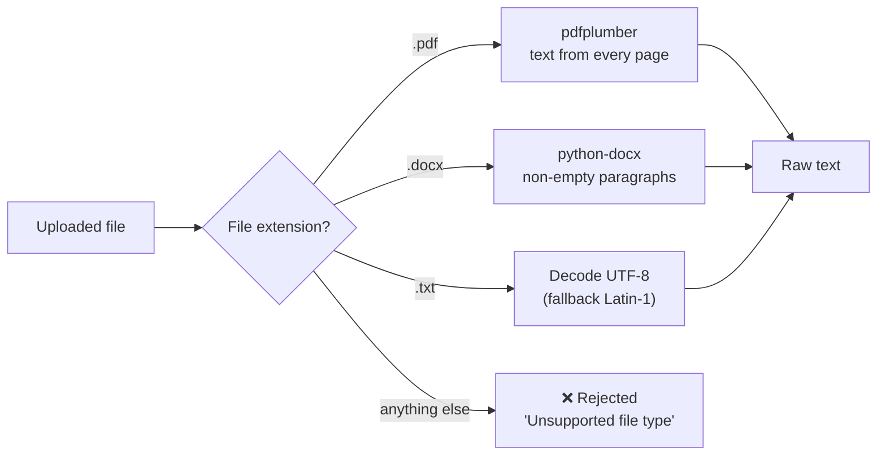

> The document parser (`resume_parser.py`) **only turns files into text**. It contains no skill lists, regex rules or keyword matching. All understanding of the content is done by the LLM.

---

### Resume processing pipeline

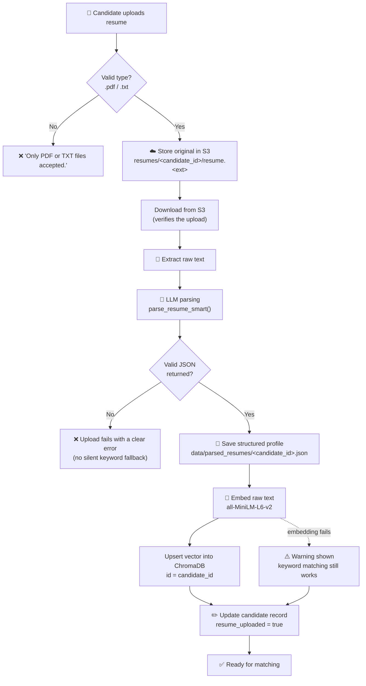

#### What the LLM extracts from a resume

The LLM acts as an expert technical recruiter and must reply with strict JSON:

```json
{
  "skills": ["Python", "Flask", "Docker", "SQL", "AWS"],
  "experience_years": 3,
  "education": "B.Tech",
  "summary": "Backend developer with three years of experience building Python web services ..."
}
```

| Field | Description |
|---|---|
| `skills` | Every skill found in the resume, normalised (no fixed list, so new or niche tools are captured) |
| `experience_years` | Total years of experience. If not stated, the LLM **infers it from job date ranges** |
| `education` | Highest level of education (e.g. B.Tech, Masters, PhD) |
| `summary` | A 2-sentence profile summary |

The saved profile also keeps the full `raw_text`, which is used for embeddings and for the Stage 2 match analysis.

#### Re-uploading a resume

Uploading a new resume **replaces everything** from the previous one in the same request, so matching never uses stale data:

| Artifact | How it's replaced |
|---|---|
| Original file in S3 | Same object key → overwritten |
| Parsed profile JSON | Same file name (`<candidate_id>.json`) → overwritten |
| Resume vector in ChromaDB | Same document ID (`candidate_id`) → upserted |

---

### Job description processing

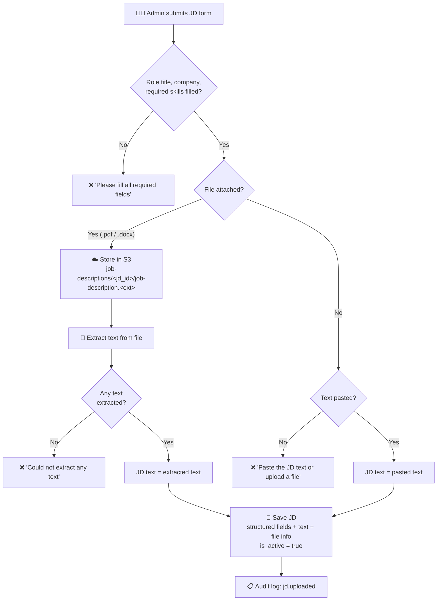

#### What a saved JD contains

| Field | Source | Example |
|---|---|---|
| `jd_id` | Generated | `jd_1a2b3c4d` |
| `role_title` | Form | Python Backend Developer |
| `company` | Form | `<company-name>` |
| `location` | Form (default *Remote*) | Remote |
| `required_skills` | Form (comma-separated) | Python, Flask, PostgreSQL, Docker |
| `preferred_skills` | Form (comma-separated) | AWS, Redis |
| `experience_years` | Form | 4 |
| `jd_text` | Pasted text **or** extracted from the file | Full description |
| `is_active` | System | `true` |
| `uploaded_by` / `created_at` | System | Admin ID, UTC timestamp |
| `jd_file_key` / `jd_original_filename` / `jd_content_type` | System (file uploads only) | S3 key, original name, MIME type |

When editing a JD, an admin can attach a replacement file. It overwrites the same S3 key and replaces the JD text; otherwise any newly typed text is used.

---

### File storage layout (AWS S3)

Original documents are kept in a **private** S3 bucket (no public ACLs) using a **deterministic key scheme**: one current document per candidate and per JD.

```mermaid
flowchart LR
    B[("🪣 &lt;your-s3-bucket&gt;")] --> R["resumes/"]
    B --> J["job-descriptions/"]
    R --> R1["&lt;candidate_id&gt;/"] --> R2["📄 resume.pdf<br/>or resume.txt"]
    J --> J1["&lt;jd_id&gt;/"] --> J2["📄 job-description.pdf<br/>or job-description.docx"]
```

| Document | S3 key pattern | Example |
|---|---|---|
| Resume | `resumes/<candidate_id>/resume.<ext>` | `resumes/cand_ab12cd34/resume.pdf` |
| JD document | `job-descriptions/<jd_id>/job-description.<ext>` | `job-descriptions/jd_1a2b3c4d/job-description.docx` |

S3 credentials and region come from the standard AWS environment variables; nothing is hardcoded (see [Configuration Reference](#configuration-reference)).

---

### Where everything ends up

After a resume and a JD are processed, their data is spread across these stores:

```mermaid
flowchart LR
    RES["📄 Resume"] --> S3R[("S3<br/>original file")]
    RES --> PJ[("parsed_resumes/<br/>&lt;candidate_id&gt;.json<br/>skills · experience · education<br/>summary · raw text")]
    RES --> CH[("ChromaDB<br/>resume vector")]
    RES --> CJ[("candidates.json<br/>resume_uploaded · S3 key")]

    JD["📋 Job Description"] --> S3J[("S3<br/>original file (if uploaded)")]
    JD --> JJ[("jds/jds.json<br/>structured fields + text")]

    LLMC["🤖 Every LLM parse"] --> PG[("PostgreSQL<br/>llm_call row")]
```

---

## AI / LLM Layer

All generative AI in TalentLink runs through a single, controlled layer in `llm/`. Routes never call a model directly: every request is **status-checked**, **queued**, **traced** and **logged**.

### Local LLMs with Ollama

TalentLink runs models locally on an [Ollama](https://ollama.com) server (default `http://localhost:11434`), so resume and JD text is never sent to a third-party AI API.

| Setting | Default | Purpose |
|---|---|---|
| Provider | `ollama` | The only provider implemented today |
| Default model | `llama3.2:latest` | Used when no model is selected |
| Temperature | `0.2` | Low randomness for consistent, structured JSON |
| Timeout | `120` seconds | Maximum time for one generation call |
| Streaming | Off | The full response is returned at once |

### The three AI tasks

| Task | Function | Input | Output | Used by |
|---|---|---|---|---|
| **Resume parsing** | `parse_resume_smart()` | Raw resume text | Skills, experience years, education, summary | Candidate resume upload |
| **Match explanation** | `explain_match()` | Resume text + JD text | AI score, verdict, reasoning, matched / missing skills | Admin ranking (Stage 2) |
| **JD parsing** | `parse_jd_smart()` | Raw JD text | Required / preferred skills, experience, role title | Available in the service layer, reserved for JD auto-fill (see [Roadmap](#roadmap)) |

Every prompt (in `llm/prompts.py`) instructs the model to return **only valid JSON** in a fixed shape. The service extracts the first JSON object from the reply and validates it before using it.

---

### How every AI request is handled

```mermaid
flowchart TD
    REQ["🧩 AI task requested<br/>parse resume · explain match · parse JD"] --> FAC["Model Factory<br/>resolve requested model<br/>(or the default)"]
    FAC --> REG{"Model in registry<br/>and status = active?"}
    REG -- "No: missing / inactive / retired" --> REJ["🚫 Rejected<br/>llm_call status = rejected"]
    REG -- Yes --> Q["Queue Manager<br/>wait for a free slot"]
    Q --> QT{"Slot free within<br/>QUEUE_TTL_SECS?"}
    QT -- No --> TMO["⏱️ Server busy<br/>llm_call status = timeout"]
    QT -- Yes --> SPAN["Open trace span<br/>llm.&lt;task&gt;"]
    SPAN --> OLL["Ollama Client<br/>POST /api/generate"]
    OLL --> NET{"Call succeeded?"}
    NET -- No --> ERR1["❌ Network / HTTP error<br/>llm_call status = error"]
    NET -- Yes --> JS{"Reply contains<br/>valid JSON?"}
    JS -- No --> ERR2["❌ Invalid output<br/>llm_call status = error"]
    JS -- Yes --> OK["✅ Structured result returned<br/>llm_call status = ok<br/>tokens · latency · trace IDs stored"]

    style REJ fill:#ffebee,stroke:#e53935,color:#000
    style TMO fill:#fff8e1,stroke:#f9a825,color:#000
    style ERR1 fill:#ffebee,stroke:#e53935,color:#000
    style ERR2 fill:#ffebee,stroke:#e53935,color:#000
    style OK fill:#e8f5e9,stroke:#43a047,color:#000
```

#### Components

| Component | File | What it does |
|---|---|---|
| **LLM client interface** | `llm/base.py` | Abstract `LLMClient` with one method, `generate(prompt)`. Routes and services depend only on this interface, so new providers can be added without touching them |
| **Ollama client** | `llm/ollama_client.py` | Implements `generate()` against Ollama's `/api/generate`, returning text plus prompt / completion token counts |
| **Model factory** | `llm/factory.py` | Looks up the model in the registry, falls back to the default if none is selected, and rejects any model that isn't `active` |
| **Queue manager** | `llm/queue_manager.py` | A bounded semaphore that allows at most `QUEUE_MAX_CONCURRENT` LLM calls at once; callers wait up to `QUEUE_TTL_SECS` and then fail fast. The slot is always released, even if the call errors |
| **Prompts** | `llm/prompts.py` | The three prompt templates, each requiring strict JSON |
| **LLM service** | `llm/llm_service.py` | Ties it together: gate → queue → span → call → validate → record |

#### Queue behaviour

The queue protects the Ollama server (and the machine it runs on) from being overloaded when many requests arrive at once.

```mermaid
sequenceDiagram
    participant R1 as Request 1
    participant R2 as Request 2
    participant R3 as Request 3
    participant Q as Queue<br/>(max 2 slots)
    participant O as Ollama

    R1->>Q: acquire slot
    Q-->>R1: ✅ slot 1
    R2->>Q: acquire slot
    Q-->>R2: ✅ slot 2
    R3->>Q: acquire slot
    Note over R3,Q: Both slots busy, R3 waits<br/>(up to QUEUE_TTL_SECS)
    R1->>O: generate
    O-->>R1: response
    R1->>Q: release slot 1
    Q-->>R3: ✅ slot 1
    R3->>O: generate
    Note over R3,Q: If no slot frees in time,<br/>R3 gets "Server busy" instead of hanging
```

| Setting | Default | Meaning |
|---|---|---|
| `QUEUE_MAX_CONCURRENT` | `2` | Maximum LLM calls running at the same time |
| `QUEUE_TTL_SECS` | `180` | How long a request waits for a slot before failing |

---

### Model registry

Every model TalentLink can use is recorded in the `model_registry` database table with a **lifecycle status**. The registry is seeded automatically on startup.

| Model ID | Display name | Family | Purpose | Seeded status |
|---|---|---|---|---|
| `llama3.2:latest` | Llama 3.2 (fast) | llama | reasoning | ✅ active (**default**) |
| `llama3:latest` | Llama 3 (balanced) | llama | reasoning | ✅ active |
| `deepseek-r1:latest` | DeepSeek R1 (deep reasoning) | deepseek | reasoning | ✅ active |
| `deepseek-r1:1.5b` | DeepSeek R1 1.5B (tiny) | deepseek | reasoning | ⏸️ inactive |
| `nomic-embed-text:latest` | Nomic Embed Text | nomic | embedding | ✅ active |

> Each model must also be downloaded in Ollama (`ollama pull <model-id>`) before it can respond. See [Getting Started](#getting-started).

#### Model lifecycle

Admins change a model's status from the **Models** page. The status is re-checked on **every** request, so a change takes effect immediately.

```mermaid
stateDiagram-v2
    [*] --> active: Seeded / activated
    active --> inactive: Deactivate
    inactive --> active: Activate
    active --> retired: Retire
    inactive --> retired: Retire
    retired --> active: Activate

    note right of active
        Can be selected and called
    end note
    note right of retired
        Rejected on every request
    end note
```

| Status | Selectable in UI | Calls allowed | Typical use |
|---|:---:|:---:|---|
| `active` | ✅ | ✅ | Models in normal use |
| `inactive` | ❌ | ❌ | Temporarily switched off (e.g. too slow, under evaluation) |
| `retired` | ❌ | ❌ | Permanently phased out, kept for history |

#### Choosing a model

Admins pick which model powers the AI analysis, trading speed for quality. The choice is stored in the admin's session and used for Stage 2 ranking.

```mermaid
sequenceDiagram
    autonumber
    actor A as Admin
    participant AR as Admin Routes
    participant DB as model_registry
    participant S as Session

    A->>AR: GET /admin/models
    AR->>DB: List all models
    AR-->>A: Models page (status, family, purpose, current selection)
    A->>AR: POST /admin/models/select (model_id)
    AR->>DB: Look up model
    alt Model is active
        AR->>S: selected_model = model_id
        AR-->>A: ✅ "Model set to <model_id>"
    else Not found / not active
        AR-->>A: ❌ "Model is inactive, cannot select"
    end
    Note over A,S: Next ranking request uses the selected model.<br/>No selection = default model.
```

---

### When the AI is unavailable

Each task fails in a way that suits its purpose:

| Situation | Resume parsing | Match explanation (Stage 2) | JD parsing |
|---|---|---|---|
| Model inactive / retired / missing | ❌ Upload fails with a clear error | Candidate keeps Stage 1 scores | Returns nothing (manual input kept) |
| Queue full (timeout) | ❌ Upload fails with a clear error | Candidate keeps Stage 1 scores | Returns nothing |
| Ollama down / network error | ❌ Upload fails with a clear error | Candidate keeps Stage 1 scores | Returns nothing |
| Invalid JSON returned | ❌ Upload fails with a clear error | Candidate keeps Stage 1 scores | Returns nothing |

Resume parsing is **LLM-only by design**: a failed parse stops the upload instead of silently producing a lower-quality keyword profile. Every outcome, including failures, is recorded in the `llm_call` table (see [Data & Storage](#data--storage)).

---

## Data & Storage

TalentLink keeps different kinds of data in the store best suited to each: small JSON files for accounts and jobs, a vector database for embeddings, PostgreSQL for operational and observability data, and S3 for original documents.

### Storage overview

```mermaid
flowchart TB
    APP["🌐 TalentLink"]

    subgraph LOCAL["💻 Local disk (data/)"]
        direction LR
        J1[("candidates.json<br/>candidate accounts")]
        J2[("admins.json<br/>admin accounts")]
        J3[("jds/jds.json<br/>job descriptions")]
        J4[("parsed_resumes/<br/>structured profiles")]
        V[("chroma/<br/>ChromaDB vectors")]
    end

    subgraph DB["🐘 PostgreSQL"]
        direction LR
        T1[("model_registry")]
        T2[("llm_call")]
        T3[("request_trace")]
        T4[("role")]
        T5[("user_account")]
    end

    subgraph CLOUD["☁️ AWS"]
        direction LR
        S3[("S3 bucket<br/>original files")]
        CW[("CloudWatch<br/>logs (optional)")]
    end

    LOGS[("📜 logs/app.jsonl<br/>rotating JSON logs")]

    APP --> LOCAL
    APP --> DB
    APP --> S3
    APP --> LOGS
    LOGS -.-> CW
```

| Store | Technology | Holds | Why this store |
|---|---|---|---|
| **Account & job store** | JSON files | Candidates, admins, job descriptions | Simple, human-readable records |
| **Profile store** | JSON files (one per candidate) | AI-parsed resume profiles + raw text | Fast lookup by candidate ID |
| **Vector store** | ChromaDB (persistent, on disk) | Resume embeddings | Fast similarity search |
| **Relational database** | PostgreSQL via SQLAlchemy | Model registry, LLM call log, request traces, roles | Queryable history, constraints, indexes |
| **Object storage** | AWS S3 (private bucket) | Original resume and JD files | Durable, secure file storage |
| **Log files** | Rotating JSON lines | Every application event | Debugging and audit trail |

---

### PostgreSQL schema

Tables are created automatically on startup (`init_db()`), and `model_registry` and `role` are seeded. The connection is set with `DATABASE_URL` (e.g. `postgresql+psycopg2://<db-user>:<db-password>@<db-host>:5432/<db-name>`). Because it goes through SQLAlchemy, SQLite also works for local development.

```mermaid
erDiagram
    ROLE ||--o{ USER_ACCOUNT : "assigned to"
    MODEL_REGISTRY ||--o{ LLM_CALL : "model_id"
    REQUEST_TRACE ||--o{ LLM_CALL : "trace_id"

    MODEL_REGISTRY {
        int id PK
        string model_id UK "e.g. llama3.2:latest"
        string family "llama | deepseek | nomic"
        string provider "ollama"
        string display_name
        string purpose "reasoning | parsing | embedding"
        string status "active | inactive | retired"
        bool is_default
        int max_tokens
        text notes
        datetime created_at
        datetime updated_at
    }

    LLM_CALL {
        int id PK
        string trace_id "request it belongs to"
        string span_id "pipeline stage"
        string model_id
        string family
        string provider
        string task "parse_resume | parse_jd | explain_match"
        text request_body "prompt (truncated)"
        text response_body "reply (truncated)"
        int prompt_tokens
        int completion_tokens
        float latency_ms
        string status "ok | error | timeout | rejected"
        text error_msg
        datetime created_at
    }

    REQUEST_TRACE {
        int id PK
        string trace_id UK
        string route
        string method
        string user_id
        string role
        datetime started_at
        datetime ended_at
        float total_latency_ms
        int status_code
        text stage_summary "JSON: spans + timings"
    }

    ROLE {
        int id PK
        string name UK "admin | recruiter | candidate"
        text permissions "JSON list"
        datetime created_at
    }

    USER_ACCOUNT {
        int id PK
        string user_id UK
        string name
        string email UK
        string password_hash
        int role_id FK
        bool is_active
        datetime created_at
    }
```

| Table | One row per | Purpose |
|---|---|---|
| `model_registry` | Model | Which models exist and whether they may be used |
| `llm_call` | LLM invocation | Full record of every AI call: prompt, reply, tokens, latency, outcome (request / response bodies truncated to 8,000 characters) |
| `request_trace` | HTTP request | End-to-end summary: route, user, status code, total latency |
| `role` | Role | RBAC roles and their permission lists |
| `user_account` | User | RBAC-ready account table, prepared for moving accounts into PostgreSQL (see [Roadmap](#roadmap)) |

> `model_id` and `trace_id` link tables logically for querying; they are not enforced as foreign keys, so logging never blocks a request.

---

### File-based records

Accounts, jobs and profiles are stored as JSON under `data/` and linked by ID:

```mermaid
erDiagram
    CANDIDATE ||--o| PARSED_RESUME : "candidate_id"
    CANDIDATE ||--o| RESUME_VECTOR : "candidate_id"
    CANDIDATE ||--o| S3_RESUME : "resume_file"
    ADMIN ||--o{ JOB_DESCRIPTION : "uploaded_by"
    JOB_DESCRIPTION ||--o| S3_JD_FILE : "jd_file_key"

    CANDIDATE {
        string candidate_id PK "cand_xxxxxxxx"
        string name
        string email UK
        string password_hash "bcrypt"
        string target_role
        bool resume_uploaded
        string resume_file "S3 key"
        string role "candidate"
        string registered_at
    }

    ADMIN {
        string admin_id PK "admin_xxxxxxxx"
        string name
        string email UK
        string password_hash "bcrypt"
        string role "admin"
        string registered_at
    }

    JOB_DESCRIPTION {
        string jd_id PK "jd_xxxxxxxx"
        string role_title
        string company
        list required_skills
        list preferred_skills
        int experience_years
        text jd_text
        string location
        bool is_active
        string uploaded_by FK
        string created_at
        string jd_file_key "optional"
        string jd_original_filename "optional"
        string jd_content_type "optional"
    }

    PARSED_RESUME {
        text raw_text
        list skills
        float experience_years
        string education
        string summary
    }

    RESUME_VECTOR {
        string id "candidate_id"
        vector embedding "384 dims"
        text document "raw text"
    }

    S3_RESUME {
        string key "resumes/<candidate_id>/resume.<ext>"
    }

    S3_JD_FILE {
        string key "job-descriptions/<jd_id>/job-description.<ext>"
    }
```

| File | Contents | Created by |
|---|---|---|
| `data/candidates.json` | List of candidate accounts | Registration, resume upload |
| `data/admins.json` | List of admin accounts | Admin registration |
| `data/jds/jds.json` | List of job descriptions | JD upload / edit / (de)activate |
| `data/parsed_resumes/<candidate_id>.json` | One AI-parsed profile per candidate | Resume upload |
| `data/chroma/` | ChromaDB database files (collection `resumes`) | Resume upload, `backfill_vectors.py` |

> All of `data/`'s generated contents (accounts, profiles, vectors) plus `logs/` and `.env` should stay out of version control. The provided `.gitignore` already excludes most of them.

---

### End-to-end data flow

Three input lanes (accounts, resumes, jobs) fill the stores, and the matching engine reads from all of them.

```mermaid
flowchart LR
    REG["📝 Registration"] --> AUTH["Validate +<br/>bcrypt hash"] --> ACC[("Accounts<br/>JSON")]

    RES["📄 Resume file"] --> S3A[("S3<br/>original")]
    RES --> PARSE["Text extraction<br/>+ LLM parsing"] --> PRO[("Profiles<br/>JSON")]
    PARSE --> EMB["Embedding<br/>MiniLM"] --> VEC[("Vectors<br/>ChromaDB")]

    JDI["📋 JD form / file"] --> S3B[("S3<br/>original")]
    JDI --> VAL["Validate +<br/>text extraction"] --> JDS[("Jobs<br/>JSON")]

    ACC & PRO & VEC & JDS --> MATCH{{"⚙️ Matching engine<br/>+ LLM explanation"}}

    MATCH --> O2["📊 Job matches<br/>(candidate)"]
    MATCH --> O3["🏆 Ranked candidates<br/>(admin)"]
    PRO --> O1["👤 Candidate profile"]
    JDS --> O4["📃 JD listings"]

    PARSE -.-> OPS[("PostgreSQL<br/>llm_call log")]
    MATCH -.-> OPS

    style MATCH fill:#ede7f6,stroke:#5e35b1,color:#000
```

---

## Observability

TalentLink is **observable by default**. Every HTTP request, pipeline stage and LLM call is logged as structured JSON and tied together with trace IDs, so you can follow a single click from the browser all the way to the model and back.

### Overview

```mermaid
flowchart LR
    H["Request hooks<br/>request.received / completed"]
    AU["Auto-audit<br/>action (POST / PUT / DELETE)"]
    SP["Trace spans<br/>&lt;stage&gt;.start / end / error"]
    AE["App events<br/>jd.uploaded · model.selected · …"]
    LL["LLM service<br/>llm.&lt;task&gt;.done · errors"]

    F["🧾 JSON formatter<br/>adds trace_id + span_id"]

    FILE[("📜 logs/app.jsonl<br/>rotating 10 MB × 5")]
    CON["🖥️ Console (stdout)"]
    CW[("☁️ AWS CloudWatch<br/>PII-redacted copy<br/>(optional)")]
    RT[("🐘 request_trace<br/>1 row / request")]
    LC[("🐘 llm_call<br/>1 row / LLM call")]

    H --> RT
    H & AU & SP & AE & LL --> F
    F --> FILE
    F --> CON
    F -. "LOG_TO_CLOUDWATCH=true" .-> CW
    LL --> LC
```

| Signal | Where it goes | What it answers |
|---|---|---|
| **Structured logs** | `logs/app.jsonl`, console, CloudWatch (optional) | *What happened, in what order?* |
| **Traces** (`trace_id`, `span_id`) | Every log line + `request_trace` + `llm_call` | *Which events belong to the same request and stage?* |
| **Request records** | `request_trace` table | *Which routes are slow or failing? Who called them?* |
| **LLM call records** | `llm_call` table | *Which model, how many tokens, how long, did it succeed?* |
| **Audit trail** | `action` log events | *Who changed what, and when?* |

---

### Traces and spans

- A **`trace_id`** is created when a request arrives and stays the same for everything that request triggers.
- A **`span_id`** is created for each timed stage inside it (Stage 1 shortlist, Stage 2 LLM, each individual LLM call).
- Both live in context variables, so any function deep in the call stack logs with the right IDs automatically.

**Example: an admin ranks candidates for a JD** (one trace, several spans; timings are illustrative)

```mermaid
gantt
    title One request = one trace_id, one span_id per stage
    dateFormat x
    axisFormat %S.%Ls

    section Request
    request.received → request.completed   :r1, 0, 9000

    section Stage 1
    match.stage1_shortlist (all candidates)  :s1, 50, 850

    section Stage 2
    match.stage2_llm                       :s2, 850, 8900
    llm.explain_match (candidate 1)        :l1, 900, 3500
    llm.explain_match (candidate 2)        :l2, 3500, 6200
    llm.explain_match (candidate 3)        :l3, 6200, 8850
```

The whole timeline can be pulled back out of the logs with one filter on its `trace_id`.

### Log lifecycle of a request

For a state-changing request (e.g. deactivating a JD), the log shows this sequence:

```mermaid
sequenceDiagram
    participant B as Browser
    participant H as Request Hooks
    participant V as Route
    participant L as Log (app.jsonl)
    participant DB as request_trace

    B->>H: POST /admin/jds/<jd_id>/delete
    H->>L: request.received (trace_id, route, method, user, role)
    H->>V: run route
    V->>L: jd.deactivated (jd_id, role_title, actor)
    V-->>H: response
    H->>L: action (admin.jds.delete, actor, form*, status, latency)
    H->>L: request.completed (status_code, latency_ms)
    H->>DB: insert request_trace row
    H-->>B: redirect
    Note over H,L: * sensitive form fields are redacted
```

| Event | Emitted | Key fields |
|---|---|---|
| `request.received` | Start of every request | `route`, `method`, `user_id`, `role` |
| `<stage>.start` / `.end` / `.error` | Around each traced stage | `stage`, `latency_ms`, `error` |
| `llm.<task>.done` | After each successful LLM call | `model_id`, `latency_ms`, `prompt_tokens`, `completion_tokens`, `parsed_ok` |
| `action` | Every `POST` / `PUT` / `PATCH` / `DELETE` | `action`, `actor`, `role`, `route`, `form` (redacted), `status_code`, `latency_ms` |
| `jd.*`, `model.*` | Specific admin actions | IDs, titles, actor |
| `request.completed` | End of every request | `status_code`, `latency_ms` |
| `request.exception` | Unhandled error | `route`, `error` |

### Log format

Each line in `logs/app.jsonl` is one JSON object:

```json
{"ts": "2026-01-01T10:15:02.114Z", "level": "INFO", "logger": "request", "event": "request.received", "trace_id": "<trace-id>", "span_id": "-", "route": "/admin/candidates-for-jd/<jd-id>", "method": "GET", "user_id": "<admin-id>", "role": "admin"}
{"ts": "2026-01-01T10:15:04.870Z", "level": "INFO", "logger": "llm", "event": "llm.explain_match.done", "trace_id": "<trace-id>", "span_id": "<span-id>", "model_id": "llama3.2:latest", "latency_ms": 2604.3, "prompt_tokens": 812, "completion_tokens": 146, "parsed_ok": true}
{"ts": "2026-01-01T10:15:11.002Z", "level": "INFO", "logger": "request", "event": "request.completed", "trace_id": "<trace-id>", "span_id": "-", "route": "/admin/candidates-for-jd/<jd-id>", "method": "GET", "status_code": 200, "latency_ms": 8888.1}
```

| Field | Always present | Description |
|---|:---:|---|
| `ts` | ✅ | UTC timestamp |
| `level` | ✅ | `INFO`, `WARNING`, `ERROR`… |
| `logger` | ✅ | Source: `request`, `span`, `llm`, `queue`, `matcher`, `admin.action`, … |
| `event` | ✅ | Event name |
| `trace_id` | ✅ | Request-wide ID |
| `span_id` | ✅ | Stage ID (`-` outside a span) |
| *(extra)* | | Event-specific fields |

Log files rotate at **10 MB**, keeping **5** backups. Noisy third-party libraries (HTTP clients, sentence-transformers, ChromaDB, SQLAlchemy, Werkzeug, etc.) are limited to `WARNING` so the log stays focused on TalentLink's own events.

---

### Privacy and redaction

Two layers keep sensitive data out of logs:

```mermaid
flowchart LR
    E["Log event"] --> R1["Layer 1: form redaction<br/>(all destinations)"]
    R1 --> FILE[("Local file<br/>+ console")]
    R1 --> R2["Layer 2: PII masking<br/>(CloudWatch only)"]
    R2 --> CW[("CloudWatch")]
```

| Layer | Applies to | Masked with `***` |
|---|---|---|
| **1. Form redaction** | Every destination | Form fields `password`, `confirm_password`, `admin_key`, `token`, `secret` |
| **2. PII masking** | CloudWatch copy only (`CLOUDWATCH_REDACT=true`, the default) | Fields `email`, `name`, `full_name`, `phone`, `address`, `raw_text`, `summary` (at any nesting level), plus any email address found in any text |

Local logs keep full detail for debugging, while logs that leave the machine carry no candidate identities.

---

### Shipping logs to AWS CloudWatch (optional)

CloudWatch shipping is **off by default** and switched on with a single flag. The same JSON events are batched to CloudWatch every few seconds, where they can be searched with CloudWatch Logs Insights or visualised in Grafana through its CloudWatch data source.

| Setting | Default | Description |
|---|---|---|
| `LOG_TO_CLOUDWATCH` | `false` | Turn CloudWatch shipping on |
| `CLOUDWATCH_LOG_GROUP` | `resume-jd-portal` | Log group name (created automatically) |
| `CLOUDWATCH_LOG_STREAM` | *(blank)* | Stream name; blank = `<hostname>-<date>` |
| `CLOUDWATCH_REGION` | `AWS_REGION` | AWS region for the logs |
| `CLOUDWATCH_RETENTION_DAYS` | `30` | How long CloudWatch keeps the logs |
| `CLOUDWATCH_REDACT` | `true` | Apply PII masking to the CloudWatch copy |

Requirements: the `watchtower` package (in `requirements.txt`) and AWS credentials allowed to create and write CloudWatch log groups and streams. If anything is missing, a warning is logged and the app **keeps running** with local logging only.

---

### Useful queries

**Follow one request in the log file**

```bash
grep '"trace_id": "<trace-id>"' logs/app.jsonl
```

**LLM performance by model** (PostgreSQL)

```sql
SELECT model_id,
       COUNT(*)                                   AS calls,
       ROUND(AVG(latency_ms)::numeric, 1)         AS avg_latency_ms,
       SUM(prompt_tokens + completion_tokens)     AS total_tokens,
       SUM(CASE WHEN status <> 'ok' THEN 1 ELSE 0 END) AS failures
FROM llm_call
GROUP BY model_id
ORDER BY calls DESC;
```

**Slowest routes in the last 24 hours**

```sql
SELECT route, method,
       COUNT(*)                             AS requests,
       ROUND(AVG(total_latency_ms)::numeric, 1) AS avg_ms,
       MAX(total_latency_ms)                AS max_ms
FROM request_trace
WHERE started_at > NOW() - INTERVAL '24 hours'
GROUP BY route, method
ORDER BY avg_ms DESC
LIMIT 10;
```

---

## Tech Stack

### Layered view

```mermaid
flowchart TB
    L1["<b>🖥️ Presentation</b><br/>Jinja2 templates · HTML · CSS · vanilla JS"]
    L2["<b>🌐 Web application</b><br/>Flask (blueprints · sessions · hooks) · bcrypt"]
    L3["<b>🤖 AI & matching</b><br/>Ollama (Llama 3.2 · Llama 3 · DeepSeek R1) · sentence-transformers (MiniLM) · ChromaDB"]
    L4["<b>📄 Document processing</b><br/>pdfplumber · python-docx"]
    L5["<b>💾 Data</b><br/>PostgreSQL / SQLite · SQLAlchemy 2.x · psycopg2 · JSON files"]
    L6["<b>☁️ Cloud & operations</b><br/>AWS S3 · Secrets Manager · CloudWatch (boto3 · watchtower) · GitHub Actions · pytest"]

    L1 --> L2
    L2 --> L3
    L2 --> L4
    L3 --> L5
    L4 --> L5
    L5 --> L6

    style L1 fill:#e3f2fd,stroke:#1e88e5,color:#000
    style L2 fill:#e8f5e9,stroke:#43a047,color:#000
    style L3 fill:#ede7f6,stroke:#5e35b1,color:#000
    style L4 fill:#fff3e0,stroke:#fb8c00,color:#000
    style L5 fill:#fce4ec,stroke:#d81b60,color:#000
    style L6 fill:#eceff1,stroke:#546e7a,color:#000
```

### By layer

| Layer | Technology | Role in TalentLink |
|---|---|---|
| **Language** | Python 3.11 | Whole application (also the version used in CI) |
| **Web framework** | [Flask](https://flask.palletsprojects.com/) | Routing (3 blueprints), server-side sessions, request hooks, Jinja2 templating |
| **UI** | Jinja2 + HTML / CSS / vanilla JS | 17 server-rendered pages on a shared base layout; no build step, no external CDNs |
| **Authentication** | [bcrypt](https://pypi.org/project/bcrypt/) | Salted password hashing and verification |
| **LLM runtime** | [Ollama](https://ollama.com) | Runs Llama 3.2, Llama 3 and DeepSeek R1 locally |
| **LLM client** | [requests](https://requests.readthedocs.io/) | Calls Ollama's `/api/generate` HTTP endpoint |
| **Embeddings** | [sentence-transformers](https://www.sbert.net/) · `all-MiniLM-L6-v2` | 384-dimension text embeddings for semantic matching |
| **Vector database** | [ChromaDB](https://www.trychroma.com/) | Persistent on-disk store for resume vectors and similarity search |
| **Relational database** | [PostgreSQL](https://www.postgresql.org/) | Model registry, LLM call log, request traces, roles |
| **ORM / driver** | [SQLAlchemy](https://www.sqlalchemy.org/) 2.x + [psycopg2](https://www.psycopg.org/) | Typed ORM models, session management; swap databases by changing one URL |
| **PDF parsing** | [pdfplumber](https://github.com/jsvine/pdfplumber) | Text extraction from PDF resumes and JDs |
| **DOCX parsing** | [python-docx](https://python-docx.readthedocs.io/) | Text extraction from Word JDs |
| **Object storage** | [AWS S3](https://aws.amazon.com/s3/) via [boto3](https://boto3.amazonaws.com/) | Private storage for original documents |
| **Secrets** | [AWS Secrets Manager](https://aws.amazon.com/secrets-manager/) via boto3 | Optional central configuration store |
| **Log shipping** | [watchtower](https://github.com/kislyuk/watchtower) | Optional CloudWatch log handler |
| **Testing** | [pytest](https://pytest.org/) | Offline unit and integration tests |
| **CI** | [GitHub Actions](https://github.com/features/actions) | Runs the test suite on every PR and push to `main` |

### Python dependencies

**Runtime** (`requirements.txt`)

| Package | Purpose |
|---|---|
| `flask` | Web framework |
| `bcrypt` | Password hashing |
| `pyjwt` | JSON Web Token library |
| `pdfplumber` | PDF text extraction |
| `python-docx` | DOCX text extraction |
| `chromadb` | Vector database |
| `sentence-transformers` | Embedding model (pulls in PyTorch) |
| `sqlalchemy` | ORM and database toolkit |
| `psycopg2-binary` | PostgreSQL driver |
| `requests` | HTTP client for Ollama |
| `boto3` | AWS SDK (S3, Secrets Manager, CloudWatch) |
| `watchtower` | CloudWatch logging handler |
| `python-dotenv` | `.env` file support |

**Development / CI** (`requirements-dev.txt`): everything above plus `pytest`.

> The first time the app computes an embedding, `sentence-transformers` downloads the `all-MiniLM-L6-v2` model (~90 MB) and caches it locally.

### External services

| Service | Required? | Used for |
|---|:---:|---|
| Ollama server | ✅ | Resume parsing and match explanations |
| PostgreSQL | ✅ (or SQLite for local dev) | Operational and observability data |
| AWS S3 bucket | ✅ | Storing uploaded resumes and JD files |
| AWS Secrets Manager | Optional | Centralised configuration |
| AWS CloudWatch | Optional | Remote log storage and search |

---

## Project Structure

### Folder map

```mermaid
flowchart LR
    subgraph APP["🧠 Application code"]
        direction TB
        CORE["<b>Root modules</b><br/>main.py · config.py · config_loader.py<br/>aws_secret_manager.py · auth.py · models.py<br/>resume_parser.py · matching_engine.py<br/>vector_matcher.py · backfill_vectors.py"]
        R["<b>routes/</b><br/>public.py · candidate.py · admin.py"]
        L["<b>llm/</b><br/>base.py · ollama_client.py · factory.py<br/>queue_manager.py · prompts.py · llm_service.py"]
        P["<b>pipeline/</b><br/>matcher.py"]
        CORE ~~~ R ~~~ L ~~~ P
    end

    subgraph INFRA["🧱 Infrastructure & data"]
        direction TB
        D["<b>db/</b><br/>database.py · models_orm.py · seed.py"]
        S["<b>storage/</b><br/>s3.py"]
        O["<b>observability/</b><br/>logging_config.py · tracing.py<br/>request_hooks.py · audit.py · cloudwatch.py"]
        DA["<b>data/</b><br/>candidates.json · admins.json · jds/<br/>parsed_resumes/ · chroma/"]
        D ~~~ S ~~~ O ~~~ DA
    end

    subgraph PROJ["📦 UI, tests & project files"]
        direction TB
        T["<b>templates/</b><br/>base.html + 17 pages"]
        TE["<b>tests/</b><br/>conftest.py + 13 test modules"]
        G["<b>.github/</b><br/>workflows/tests.yml · CODEOWNERS"]
        DOC["<b>Docs & config</b><br/>README.md · design docs<br/>requirements*.txt · pytest.ini · env.example"]
        T ~~~ TE ~~~ G ~~~ DOC
    end

    APP ~~~ INFRA ~~~ PROJ

    style APP fill:#e3f2fd,stroke:#1e88e5,color:#000
    style INFRA fill:#e8f5e9,stroke:#43a047,color:#000
    style PROJ fill:#fff3e0,stroke:#fb8c00,color:#000
```

### How the modules depend on each other

```mermaid
flowchart TD
    MAIN["main.py"] --> ROUTES["routes/"]
    MAIN --> DB["db/"]
    MAIN --> OBS["observability/"]

    ROUTES --> AUTH["auth.py"]
    ROUTES --> PARSER["resume_parser.py"]
    ROUTES --> STORAGE["storage/"]
    ROUTES --> PIPE["pipeline/"]
    ROUTES --> ENGINE["matching_engine.py"]
    ROUTES --> VEC["vector_matcher.py"]
    ROUTES --> LLM["llm/"]

    PIPE --> ENGINE
    PIPE --> VEC
    PIPE --> LLM

    AUTH --> MODELS["models.py"]
    LLM --> DB
    LLM --> OBS
    OBS --> DB

    CONFIG["config.py<br/>config_loader.py<br/>aws_secret_manager.py"]
    AUTH & STORAGE & LLM & VEC & DB & OBS -.-> CONFIG

    style CONFIG fill:#fff8e1,stroke:#f9a825,color:#000
    style MAIN fill:#e3f2fd,stroke:#1e88e5,color:#000
```

> Dotted arrows: nearly every module reads its settings from `config.py`.

### Annotated file tree

```text
<your-repo-name>/
│
├── main.py                        # App entry point: create_app() seeds DB, registers hooks + blueprints
├── config.py                      # All settings (paths, secrets, DB, LLM, queue, S3, logging)
├── config_loader.py               # Config resolver: AWS Secrets Manager → env vars → defaults
├── aws_secret_manager.py          # Fetches the JSON config secret from AWS Secrets Manager
├── auth.py                        # Hashing, register/login, session helpers, role decorators
├── models.py                      # Dataclasses: Candidate, Admin, JobDescription, ParsedResume, MatchResult
├── resume_parser.py               # PDF / DOCX / TXT → raw text (no parsing rules)
├── matching_engine.py             # Skill / experience / role / weighted overall scores
├── role_titles.py                 # Role-title normalisation: punctuation + synonyms (used by the role score)
├── vector_matcher.py              # MiniLM embeddings + ChromaDB: index_resume(), semantic_score()
├── backfill_vectors.py            # One-off: embed any parsed resumes missing from ChromaDB
│
├── routes/                        # Flask blueprints (HTTP layer)
│   ├── public.py                  #   /, /register, /login, /logout, /dashboard, /health
│   ├── candidate.py               #   /candidate/*: dashboard, upload, profile, job matching
│   └── admin.py                   #   /admin/*: JDs, candidates, ranking, models, users
│
├── llm/                           # Generative AI layer
│   ├── base.py                    #   LLMClient interface + LlmResult
│   ├── ollama_client.py           #   Ollama /api/generate client
│   ├── factory.py                 #   Model resolution + status gate
│   ├── queue_manager.py           #   Concurrency limit + wait timeout
│   ├── prompts.py                 #   Resume-parse, JD-parse, match-explain prompts
│   └── llm_service.py             #   parse_resume_smart, parse_jd_smart, explain_match
│
├── pipeline/
│   └── matcher.py                 # two_stage_match(): Stage 1 shortlist → Stage 2 LLM
│
├── db/                            # PostgreSQL via SQLAlchemy
│   ├── database.py                #   Engine, session factory, init_db()
│   ├── models_orm.py              #   ModelRegistry, LlmCall, RequestTrace, Role, UserAccount
│   └── seed.py                    #   Seeds models + roles (also runnable: python -m db.seed)
│
├── storage/
│   └── s3.py                      # Deterministic S3 keys, upload_file(), download_file()
│
├── observability/                 # Logging, tracing, auditing
│   ├── logging_config.py          #   JSON formatter, rotating file, console, redaction
│   ├── tracing.py                 #   trace_id / span_id context + span() timer
│   ├── request_hooks.py           #   Per-request logs, auto-audit, request_trace rows
│   ├── audit.py                   #   @audit_action decorator
│   └── cloudwatch.py              #   Optional CloudWatch handler
│
├── templates/                     # Jinja2 pages (all extend base.html)
│   ├── base.html                  #   Layout, navigation, styles
│   ├── index.html                 #   Landing page
│   ├── register.html · login.html #   Auth forms
│   ├── candidate_dashboard.html   #   Candidate home
│   ├── upload_resume.html         #   Resume upload
│   ├── profile.html               #   Parsed profile
│   ├── match_results.html         #   Ranked job list
│   ├── match_detail.html          #   One job's score breakdown
│   ├── admin_dashboard.html       #   Admin home
│   ├── upload_jd.html · edit_jd.html   # JD create / edit
│   ├── jd_list.html · jd_detail.html   # JD listing / detail
│   ├── candidate_list.html        #   All candidates
│   ├── ranked_candidates.html     #   Two-stage ranking results
│   ├── models.html                #   Model picker + status
│   └── users.html                 #   Users & roles
│
├── data/                          # Local data (generated contents are git-ignored)
│   ├── candidates.json            #   Candidate accounts
│   ├── admins.json                #   Admin accounts (created on first admin sign-up)
│   ├── jds/jds.json               #   Job descriptions
│   ├── resumes/                   #   Created at startup (original files live in S3)
│   ├── parsed_resumes/            #   <candidate_id>.json profiles (created at runtime)
│   └── chroma/                    #   ChromaDB files (created at runtime)
│
├── logs/                          # app.jsonl + rotated backups (created at runtime)
│
├── tests/                         # pytest suite (offline: in-memory DB, fakes)
│   ├── conftest.py                #   Shared fixtures (DB, fake LLM, app, client)
│   ├── README.md                  #   How to run and write tests
│   └── test_*.py                  #   13 test modules
│
├── .github/
│   ├── workflows/tests.yml        # CI: run pytest on PRs and pushes to main
│   └── CODEOWNERS                 # Required reviewers
│
├── requirements.txt               # Runtime dependencies
├── requirements-dev.txt           # + pytest
├── pytest.ini                     # Test discovery settings
├── env.example                    # Template for your .env
├── .gitignore
│
├── HYBRID_AI_ARCHITECTURE.md      # Design doc: embeddings + LLM hybrid
├── LLM_INTEGRATION_PLAN.md        # Design doc: LLM integration
├── PRODUCTION_BUILD_PLAN.md       # Design doc: staged production build
├── AWS_SECRET_MANAGER_SETUP.md    # Guide: configuring AWS Secrets Manager
└── README.md                      # You are here
```

### Folders created at runtime

On startup, `config.py` creates any missing working folders, so a fresh clone runs without extra setup:

```mermaid
flowchart LR
    S["▶️ python main.py"] --> C["config.py"]
    C --> D1["data/resumes/"]
    C --> D2["data/parsed_resumes/"]
    C --> D3["data/jds/"]
    C --> D4["data/chroma/"]
    C --> D5["logs/"]
```

---

## Getting Started

### Setup at a glance

```mermaid
flowchart TD
    A["1️⃣ Install prerequisites<br/>Python 3.11 · Ollama · PostgreSQL · AWS account"] --> B["2️⃣ Clone the repository"]
    B --> C["3️⃣ Create a virtual environment<br/>and install dependencies"]
    C --> D["4️⃣ Pull Ollama models"]
    D --> E["5️⃣ Create the database"]
    E --> F["6️⃣ Create an S3 bucket<br/>+ AWS credentials"]
    F --> G["7️⃣ Configure .env<br/>and load it"]
    G --> H["8️⃣ Run the app<br/>python main.py"]
    H --> I{"9️⃣ Health check OK?"}
    I -- Yes --> J["🎉 Open http://localhost:5000"]
    I -- No --> K["See Troubleshooting"]
```

### Prerequisites

| Requirement | Version / notes | Check |
|---|---|---|
| **Python** | 3.11 (the version used in CI) | `python3 --version` |
| **Git** | Any recent version | `git --version` |
| **Ollama** | [ollama.com/download](https://ollama.com/download) | `ollama --version` |
| **PostgreSQL** | Any supported version (or use SQLite for local development) | `psql --version` |
| **AWS account** | An S3 bucket plus an access key allowed to read and write it | `aws sts get-caller-identity` |
| **Disk space** | A few GB for PyTorch, the embedding model and Ollama models | |
| **RAM** | 8 GB+ recommended for running local LLMs | |

---

### 1. Clone the repository

```bash
git clone https://github.com/<your-github-username>/<your-repo-name>.git
cd <your-repo-name>
```

### 2. Create a virtual environment and install dependencies

**macOS / Linux**

```bash
python3.11 -m venv .venv
source .venv/bin/activate
pip install --upgrade pip
pip install -r requirements.txt
```

**Windows (PowerShell)**

```powershell
py -3.11 -m venv .venv
.venv\Scripts\Activate.ps1
pip install --upgrade pip
pip install -r requirements.txt
```

> `sentence-transformers` installs PyTorch, so the first install can take several minutes.

### 3. Set up Ollama and pull the models

Start Ollama (the desktop app starts it automatically; otherwise run `ollama serve`), then download the models:

```bash
# Required: the default model
ollama pull llama3.2

# Optional: other models listed in the model registry
ollama pull llama3
ollama pull deepseek-r1
ollama pull deepseek-r1:1.5b
ollama pull nomic-embed-text
```

Check that Ollama is reachable:

```bash
curl http://localhost:11434/api/tags
```

### 4. Create the database

**PostgreSQL (recommended)**

```bash
createdb <db-name>
```

Your connection string will look like:

```text
postgresql+psycopg2://<db-user>:<db-password>@<db-host>:5432/<db-name>
```

**SQLite (quick local setup)**: no installation needed; just use a file URL:

```text
sqlite:///talentlink.db
```

You don't need to create any tables. TalentLink creates them and seeds the model registry and roles on first start.

### 5. Create an S3 bucket

1. In the AWS console, create a bucket (e.g. `<your-s3-bucket>`) and keep **Block all public access** turned on.
2. Create an IAM user or role with permission to `s3:PutObject` and `s3:GetObject` on that bucket.
3. Note its access key ID, secret access key and the bucket's region.

### 6. Configure environment variables

Copy the template and fill in your values:

```bash
cp env.example .env
```

A complete `.env` for local development looks like this:

```dotenv
# --- Application secrets ---
SECRET_KEY=<your-secret-key>
ADMIN_KEY=<your-admin-key>

# --- Database ---
DATABASE_URL=postgresql+psycopg2://<db-user>:<db-password>@<db-host>:5432/<db-name>

# --- LLM (Ollama) ---
LLM_PROVIDER=ollama
OLLAMA_BASE_URL=http://localhost:11434
DEFAULT_LLM_MODEL=llama3.2:latest
LLM_TIMEOUT_SECS=120
LLM_TEMPERATURE=0.2

# --- Matching & queue ---
MATCH_TOP_K=10
QUEUE_MAX_CONCURRENT=2
QUEUE_TTL_SECS=180

# --- AWS S3 (file storage) ---
S3_BUCKET_NAME=<your-s3-bucket>
AWS_ACCESS_KEY_ID=<your-aws-access-key-id>
AWS_SECRET_ACCESS_KEY=<your-aws-secret-access-key>
AWS_DEFAULT_REGION=<your-aws-region>

# --- Logging ---
LOG_DIR=logs
LOG_LEVEL=INFO
LOG_TO_CLOUDWATCH=false
```

> Generate a strong `SECRET_KEY` with `python -c "import secrets; print(secrets.token_hex(32))"`. Never commit `.env`; it is already in `.gitignore`.

Every setting is explained in the [Configuration Reference](#configuration-reference).

**Load the variables into your shell** before starting the app:

macOS / Linux:

```bash
set -a; source .env; set +a
```

Windows (PowerShell):

```powershell
Get-Content .env | Where-Object { $_ -match '^\s*[^#].*=' } | ForEach-Object {
    $name, $value = $_ -split '=', 2
    [Environment]::SetEnvironmentVariable($name.Trim(), $value.Trim(), 'Process')
}
```

> Prefer a central secret store? TalentLink can read its configuration from **AWS Secrets Manager** instead. See [Configuration Reference](#configuration-reference).

### 7. Run the app

```bash
python main.py
```

You should see `Seed complete: model_registry + role tables populated.` followed by JSON log lines. The app runs at **http://localhost:5000** (Flask development server, debug mode).

### 8. Verify it works

```bash
curl http://localhost:5000/health
```

Expected response:

```json
{"service": "Resume-JD Matching Portal", "status": "healthy", "version": "1.0"}
```

---

### First-run walkthrough

```mermaid
flowchart LR
    subgraph ADMIN["🧑‍💻 As an admin"]
        direction TB
        A1["Register → role: Admin<br/>enter ADMIN_KEY"] --> A2["Upload a JD<br/>(text or PDF / DOCX)"]
    end
    subgraph CAND["🧑‍💼 As a candidate"]
        direction TB
        C1["Register → role: Candidate<br/>(use another browser / incognito)"] --> C2["Upload a resume<br/>(PDF / TXT)"]
        C2 --> C3["Find Jobs →<br/>see ranked matches"]
    end
    subgraph BACK["🧑‍💻 Back as the admin"]
        direction TB
        B1["Open the JD →<br/>view ranked candidates"] --> B2["Models page →<br/>try another LLM"]
    end
    ADMIN --> CAND --> BACK
```

1. **Register an admin.** Go to `/register`, choose **Admin**, and enter the `ADMIN_KEY` from your `.env`.
2. **Post a job.** From the admin dashboard, upload a JD with a role title, company and required skills.
3. **Register a candidate.** In a private window, register as a **Candidate** with a target role.
4. **Upload a resume.** The AI parses it; you'll see how many skills were found.
5. **Find jobs.** Open **Find Jobs** to see every active JD ranked against the resume.
6. **Rank candidates.** Back as the admin, open the JD's ranked-candidates view to see the two-stage results with AI verdicts.

---

### Running in production

`main.py` exposes a module-level `app`, so any WSGI server can serve it. For example, with Gunicorn:

```bash
pip install gunicorn
gunicorn --workers 2 --bind 0.0.0.0:5000 --timeout 300 main:app
```

- Use a long `--timeout`: LLM calls can take tens of seconds.
- The LLM queue limit (`QUEUE_MAX_CONCURRENT`) applies **per worker process**.
- Set a strong `SECRET_KEY` and `ADMIN_KEY`, and consider AWS Secrets Manager for them.
- Put a reverse proxy (e.g. Nginx) with HTTPS in front of the app.

### Utility commands

| Command | What it does |
|---|---|
| `python main.py` | Start the development server |
| `python -m db.seed` | Create tables and seed models + roles without starting the app |
| `python backfill_vectors.py` | Embed any parsed resumes that are missing from ChromaDB (e.g. after restoring data) |
| `python -m pytest` | Run the test suite (see [Testing & CI](#testing--ci)) |

---

### Troubleshooting

```mermaid
flowchart TD
    P{"What's wrong?"}
    P --> A["Resume upload fails:<br/>'LLM did not return valid JSON'"]
    P --> B["Upload fails:<br/>'Could not store … in S3'"]
    P --> C["App won't start:<br/>database connection error"]
    P --> D["'Server busy: no LLM slot'"]
    P --> E["Warning: 'semantic indexing skipped'"]

    A --> A1["Is Ollama running?<br/>Is the model pulled?<br/>Is it active on the Models page?"]
    B --> B1["Set S3_BUCKET_NAME + AWS credentials<br/>and reload .env"]
    C --> C1["Check DATABASE_URL<br/>and that the database exists"]
    D --> D1["Raise QUEUE_MAX_CONCURRENT<br/>or QUEUE_TTL_SECS"]
    E --> E1["First embedding needs internet<br/>to download the MiniLM model"]
```

| Symptom | Likely cause | Fix |
|---|---|---|
| *"Resume parsing failed: the LLM did not return valid JSON"* | Ollama not running, model not pulled, or model not `active` | Start Ollama, run `ollama pull llama3.2`, check the **Models** page |
| *"Could not store resume in S3: S3_BUCKET_NAME is not configured"* | S3 variables not loaded | Add `S3_BUCKET_NAME` and AWS credentials to `.env`, reload it, restart |
| S3 *AccessDenied* | IAM permissions | Allow `s3:PutObject` and `s3:GetObject` on the bucket |
| Database connection error on startup | Wrong `DATABASE_URL` or database missing | Fix the URL, run `createdb <db-name>`, or switch to SQLite |
| *"Server busy: no LLM slot within …"* | Too many simultaneous LLM requests | Increase `QUEUE_MAX_CONCURRENT` or `QUEUE_TTL_SECS`, or use a faster model |
| *"Model '…' is inactive, cannot select"* | Model status is not `active` | Activate it on the **Models** page |
| *"Note: semantic indexing skipped"* | Embedding model couldn't load (e.g. no internet on first run) | Restore connectivity, then run `python backfill_vectors.py` |
| *"Invalid admin key."* | Wrong key on admin registration | Use the `ADMIN_KEY` value from your configuration |
| Settings seem to be ignored | `.env` not loaded into the shell | Run `set -a; source .env; set +a` (or the PowerShell snippet), then restart |
| Ranking page is slow | Stage 2 runs the LLM on up to `MATCH_TOP_K` candidates | Lower `MATCH_TOP_K` or select a faster model (e.g. Llama 3.2) |

---

## Configuration Reference

All configuration lives in `config.py` and is read **once at startup**. Nothing needs to be edited in code: every setting comes from AWS Secrets Manager, an environment variable or a built-in default.

### How a setting is resolved

```mermaid
flowchart TD
    S["App needs a setting<br/>e.g. DATABASE_URL"] --> Q1{"AWS_SECRET_NAME and<br/>AWS_REGION set?"}
    Q1 -- No --> ENV
    Q1 -- Yes --> F["Fetch secret JSON<br/>from AWS Secrets Manager<br/>(once, at startup)"]
    F --> Q2{"Secret loaded and<br/>contains the key?"}
    Q2 -- Yes --> A["✅ Use value from<br/>Secrets Manager"]
    Q2 -- "No / AWS error" --> ENV{"Environment variable<br/>set?"}
    ENV -- Yes --> B["✅ Use environment<br/>variable"]
    ENV -- No --> C["✅ Use built-in<br/>default"]

    style A fill:#e8f5e9,stroke:#43a047,color:#000
    style B fill:#e3f2fd,stroke:#1e88e5,color:#000
    style C fill:#fff8e1,stroke:#f9a825,color:#000
```

| Priority | Source | Notes |
|:---:|---|---|
| **1** | AWS Secrets Manager | Only when `AWS_SECRET_NAME` **and** a region are set. AWS errors never crash the app; they are logged and resolution continues |
| **2** | Environment variables | From your shell, `.env` (once loaded), Docker, systemd, CI… |
| **3** | Built-in defaults | Safe for optional settings. Secrets and the database URL have **development-only placeholders**: always set them |

---

### All settings

The **SM** column shows whether the setting can also be supplied through AWS Secrets Manager (✅), or must be an environment variable (env).

#### 🔐 Security

| Variable | Default | SM | Description |
|---|---|:---:|---|
| `SECRET_KEY` | *dev placeholder* | ✅ | Signs Flask session cookies. **Set a long random value in every environment** |
| `ADMIN_KEY` | *dev placeholder* | ✅ | Shared secret required to register as an admin |

#### 🐘 Database

| Variable | Default | SM | Description |
|---|---|:---:|---|
| `DATABASE_URL` | *local dev placeholder* | ✅ | SQLAlchemy URL, e.g. `postgresql+psycopg2://<db-user>:<db-password>@<db-host>:5432/<db-name>` or `sqlite:///talentlink.db` |

#### 🤖 LLM

| Variable | Default | SM | Description |
|---|---|:---:|---|
| `LLM_PROVIDER` | `ollama` | ✅ | LLM backend (`ollama` is currently supported) |
| `OLLAMA_BASE_URL` | `http://localhost:11434` | ✅ | Where the Ollama server is running |
| `DEFAULT_LLM_MODEL` | `llama3.2:latest` | ✅ | Model used when none is selected; must exist in the model registry |
| `LLM_TIMEOUT_SECS` | `120` | ✅ | Maximum seconds for a single LLM call |
| `LLM_TEMPERATURE` | `0.2` | ✅ | Sampling temperature (lower = more consistent JSON) |

#### ⚙️ Matching & queue

| Variable | Default | SM | Description |
|---|---|:---:|---|
| `MATCH_TOP_K` | `10` | ✅ | How many top candidates get the Stage 2 LLM analysis |
| `QUEUE_MAX_CONCURRENT` | `2` | ✅ | Maximum simultaneous LLM calls (per process) |
| `QUEUE_TTL_SECS` | `180` | ✅ | Seconds a request waits for a free LLM slot before failing |

#### ☁️ AWS: storage & credentials

| Variable | Default | SM | Description |
|---|---|:---:|---|
| `S3_BUCKET_NAME` | *(empty)* | env | Private bucket for resumes and JD files. **Required for uploads** |
| `AWS_DEFAULT_REGION` | `us-east-1` | env | Region of the S3 bucket |
| `AWS_ACCESS_KEY_ID` | – | env | AWS access key (or use an IAM role / AWS profile) |
| `AWS_SECRET_ACCESS_KEY` | – | env | AWS secret key (or use an IAM role / AWS profile) |

#### 🔑 AWS Secrets Manager (bootstrap)

| Variable | Default | SM | Description |
|---|---|:---:|---|
| `AWS_SECRET_NAME` | *(unset = disabled)* | env | Name of the secret holding the JSON config, e.g. `<your-secret-name>` |
| `AWS_REGION` | *(unset)* | env | Region of the secret (falls back to `AWS_DEFAULT_REGION`) |

#### 📜 Logging & CloudWatch

| Variable | Default | SM | Description |
|---|---|:---:|---|
| `LOG_DIR` | `logs` | env ¹ | Folder for `app.jsonl` (relative to the project root) |
| `LOG_LEVEL` | `INFO` | ✅ | `DEBUG`, `INFO`, `WARNING`, `ERROR` |
| `LOG_TO_CLOUDWATCH` | `false` | ✅ | Ship logs to AWS CloudWatch |
| `CLOUDWATCH_LOG_GROUP` | `resume-jd-portal` | ✅ | CloudWatch log group |
| `CLOUDWATCH_LOG_STREAM` | *(blank = `<host>-<date>`)* | ✅ | CloudWatch log stream |
| `CLOUDWATCH_REGION` | value of `AWS_REGION` | ✅ | Region for CloudWatch |
| `CLOUDWATCH_RETENTION_DAYS` | `30` | ✅ | Log retention in CloudWatch |
| `CLOUDWATCH_REDACT` | `true` | ✅ | Mask PII in the CloudWatch copy |

¹ `LOG_DIR` is read from the environment first, then from Secrets Manager.

#### Fixed values (in code)

| Setting | Value | Where |
|---|---|---|
| Log file rotation | 10 MB × 5 backups | `config.py` |
| Embedding model | `all-MiniLM-L6-v2` | `vector_matcher.py` |
| ChromaDB collection | `resumes` in `data/chroma/` | `vector_matcher.py` |
| Dev server port | `5000` | `main.py` |

---

### Using AWS Secrets Manager

Instead of spreading secrets across servers, you can keep TalentLink's configuration in a single JSON secret.

```mermaid
sequenceDiagram
    autonumber
    participant ENV as Environment
    participant APP as TalentLink (startup)
    participant SM as AWS Secrets Manager

    ENV->>APP: AWS_SECRET_NAME, AWS_REGION, AWS credentials
    APP->>SM: GetSecretValue(<your-secret-name>)
    alt Secret found
        SM-->>APP: JSON config
        APP->>APP: Use secret values first,<br/>env vars + defaults for anything missing
    else Not found / access denied / no credentials
        SM-->>APP: error
        APP->>APP: ⚠️ Log a warning (never the secret contents)<br/>continue with env vars + defaults
    end
```

**1. Create the secret** (type *Other type of secret*, plaintext JSON):

```json
{
  "SECRET_KEY": "<your-secret-key>",
  "ADMIN_KEY": "<your-admin-key>",
  "DATABASE_URL": "postgresql+psycopg2://<db-user>:<db-password>@<db-host>:5432/<db-name>",
  "OLLAMA_BASE_URL": "http://<ollama-host>:11434",
  "DEFAULT_LLM_MODEL": "llama3.2:latest",
  "MATCH_TOP_K": 10,
  "QUEUE_MAX_CONCURRENT": 2,
  "QUEUE_TTL_SECS": 180,
  "LOG_LEVEL": "INFO",
  "LOG_TO_CLOUDWATCH": false
}
```

**2. Grant access.** The app's IAM user or role needs `secretsmanager:GetSecretValue` on that secret.

**3. Point the app at it:**

```bash
export AWS_SECRET_NAME=<your-secret-name>
export AWS_REGION=<your-aws-region>
# plus S3_BUCKET_NAME and AWS credentials (these are read from the environment)
python main.py
```

For a full walkthrough, see [`AWS_SECRET_MANAGER_SETUP.md`](AWS_SECRET_MANAGER_SETUP.md).

---

## Routes Reference

TalentLink exposes **24 routes** across three Flask blueprints. All pages are server-rendered HTML except `/health`, which returns JSON.

### Route map

```mermaid
flowchart TB
    APP(("🌐 TalentLink<br/>Flask app"))

    PUB["<b>public</b>&nbsp;·&nbsp;no&nbsp;prefix&nbsp;·&nbsp;6&nbsp;routes<br/><br/>GET&nbsp;/<br/>GET&nbsp;·&nbsp;POST&nbsp;/register<br/>GET&nbsp;·&nbsp;POST&nbsp;/login<br/>GET&nbsp;/logout<br/>GET&nbsp;/dashboard<br/>GET&nbsp;/health"]

    CAN["<b>candidate</b>&nbsp;·&nbsp;/candidate&nbsp;·&nbsp;5&nbsp;routes<br/>🔒&nbsp;login&nbsp;+&nbsp;candidate&nbsp;role<br/><br/>GET&nbsp;/dashboard<br/>GET&nbsp;·&nbsp;POST&nbsp;/upload-resume<br/>GET&nbsp;/profile<br/>GET&nbsp;/match-jobs<br/>GET&nbsp;/match-jobs/&lt;jd_id&gt;"]

    ADM["<b>admin</b>&nbsp;·&nbsp;/admin&nbsp;·&nbsp;13&nbsp;routes<br/>🔒&nbsp;login&nbsp;+&nbsp;admin&nbsp;role<br/><br/>GET&nbsp;/dashboard<br/>GET&nbsp;·&nbsp;POST&nbsp;/upload-jd<br/>GET&nbsp;/jds<br/>GET&nbsp;/jds/&lt;jd_id&gt;<br/>GET&nbsp;·&nbsp;POST&nbsp;/jds/&lt;jd_id&gt;/edit<br/>POST&nbsp;/jds/&lt;jd_id&gt;/delete<br/>POST&nbsp;/jds/&lt;jd_id&gt;/reactivate<br/>GET&nbsp;/candidates<br/>GET&nbsp;/candidates-for-jd/&lt;jd_id&gt;<br/>GET&nbsp;/models<br/>POST&nbsp;/models/select<br/>POST&nbsp;/models/&lt;model_id&gt;/status<br/>GET&nbsp;/users"]

    APP --> PUB
    APP --> CAN
    APP --> ADM

    style PUB fill:#f5f5f5,stroke:#999,color:#000
    style CAN fill:#e3f2fd,stroke:#1e88e5,color:#000
    style ADM fill:#fff3e0,stroke:#fb8c00,color:#000
```

### Page navigation

How users move between pages (the navigation bar changes by role):

```mermaid
flowchart TD
    HOME["🏠 Landing /"] --> REG["Register"]
    HOME --> LOGIN["Login"]
    REG --> DASH{"/dashboard<br/>role?"}
    LOGIN --> DASH

    DASH -- candidate --> CD["Candidate Dashboard"]
    CD --> UR["Upload Resume"]
    CD --> PR["Profile"]
    CD --> MJ["Find Jobs<br/>(match results)"]
    MJ --> MD["Match Detail<br/>(one job)"]

    DASH -- admin --> AD["Admin Dashboard"]
    AD --> UJ["Upload JD"]
    AD --> JL["Job Descriptions"]
    AD --> CL["Candidates"]
    AD --> MO["Models"]
    AD --> US["Users & Roles"]
    JL --> JDD["JD Detail"]
    JL --> EJ["Edit JD"]
    JL --> RC["Ranked Candidates"]
    JDD --> RC
    JL -. "POST" .-> DEACT["Deactivate / Reactivate"]
    MO -. "POST" .-> MSEL["Select model / change status"]

    style CD fill:#e3f2fd,stroke:#1e88e5,color:#000
    style AD fill:#fff3e0,stroke:#fb8c00,color:#000
```

---

### 🌐 Public routes

| Method | Path | Access | Renders / returns | Description |
|---|---|---|---|---|
| `GET` | `/` | Anyone | `index.html` | Landing page (logged-in users are redirected to their dashboard) |
| `GET` | `/register` | Anyone | `register.html` | Registration form |
| `POST` | `/register` | Anyone | Redirect → dashboard | Create a candidate or admin account and log in |
| `GET` | `/login` | Anyone | `login.html` | Login form |
| `POST` | `/login` | Anyone | Redirect → dashboard | Authenticate and start a session |
| `GET` | `/logout` | Anyone | Redirect → `/` | Clear the session |
| `GET` | `/dashboard` | Logged in | Redirect | Sends admins to `/admin/dashboard`, candidates to `/candidate/dashboard` |
| `GET` | `/health` | Anyone | JSON | Health check: `{"status": "healthy", …}` |

### 🧑‍💼 Candidate routes (`/candidate`)

All require login **and** the candidate role.

| Method | Path | Renders | Description |
|---|---|---|---|
| `GET` | `/candidate/dashboard` | `candidate_dashboard.html` | Account info and parsed resume summary |
| `GET` | `/candidate/upload-resume` | `upload_resume.html` | Upload form |
| `POST` | `/candidate/upload-resume` | Redirect → dashboard | Store, parse and index a resume (PDF / TXT) |
| `GET` | `/candidate/profile` | `profile.html` | Full AI-parsed profile |
| `GET` | `/candidate/match-jobs` | `match_results.html` | All active JDs ranked against the resume |
| `GET` | `/candidate/match-jobs/<jd_id>` | `match_detail.html` | Score breakdown for one JD |
| `POST` | `/candidate/target-roles` | Redirect → profile (or `next`) | Change / clear the target role(s) (comma-separated, 200 characters max) |

### 🧑‍💻 Admin routes (`/admin`)

All require login **and** the admin role.

| Method | Path | Renders | Description |
|---|---|---|---|
| `GET` | `/admin/dashboard` | `admin_dashboard.html` | Overview: JDs, active count, candidates, resumes uploaded |
| `GET` | `/admin/upload-jd` | `upload_jd.html` | New JD form |
| `POST` | `/admin/upload-jd` | Redirect → dashboard | Create a JD from typed text or a PDF / DOCX file |
| `GET` | `/admin/jds` | `jd_list.html` | All JDs, active and inactive |
| `GET` | `/admin/jds/<jd_id>` | `jd_detail.html` | One JD in full |
| `GET` | `/admin/jds/<jd_id>/edit` | `edit_jd.html` | Edit form |
| `POST` | `/admin/jds/<jd_id>/edit` | Redirect → dashboard | Save changes (optionally replace the document) |
| `POST` | `/admin/jds/<jd_id>/delete` | Redirect → dashboard | Deactivate (soft delete) |
| `POST` | `/admin/jds/<jd_id>/reactivate` | Redirect → dashboard | Reactivate |
| `GET` | `/admin/candidates` | `candidate_list.html` | All registered candidates |
| `GET` | `/admin/candidates-for-jd/<jd_id>` | `ranked_candidates.html` | Two-stage ranking with AI analysis |
| `GET` | `/admin/models` | `models.html` | Model registry and current selection |
| `POST` | `/admin/models/select` | Redirect → models | Choose the LLM for this session |
| `POST` | `/admin/models/<model_id>/status` | Redirect → models | Set status to `active`, `inactive` or `retired` |
| `GET` | `/admin/users` | `users.html` | All candidate and admin accounts |

### Form fields for `POST` routes

| Route | Fields | Required |
|---|---|---|
| `/register` | `name`, `email`, `password`, `role` (`candidate` / `admin`), `target_role`, `admin_key` | name, email, password (≥ 6 chars); `admin_key` for admins |
| `/login` | `email`, `password` | Both |
| `/candidate/upload-resume` | `resume` (file: `.pdf` / `.txt`) | Yes |
| `/admin/upload-jd` | `role_title`, `company`, `required_skills`, `preferred_skills`, `experience_years`, `location`, `jd_text`, `jd_file` (`.pdf` / `.docx`) | role_title, company, required_skills, and either `jd_text` or `jd_file` |
| `/admin/jds/<jd_id>/edit` | Same as upload (all optional) | – |
| `/admin/models/select` | `model_id` | Yes (must be `active`) |
| `/admin/models/<model_id>/status` | `status` (`active` / `inactive` / `retired`) | Yes |

Skill fields are comma-separated (e.g. `Python, Flask, Docker`).

---

## Testing & CI

TalentLink ships with a fast, fully **offline** test suite: **192 tests across 13 modules, running in a few seconds**. Tests never touch a real database, Ollama server, embedding model or AWS account.

### Running the tests

```bash
pip install -r requirements-dev.txt   # once

python -m pytest                      # run everything
python -m pytest -v                   # verbose: show every test name
python -m pytest tests/test_factory.py            # one file
python -m pytest tests/test_routes.py -k lifecycle  # tests matching a pattern
```

Settings live in `pytest.ini` (test path `tests/`, quiet output, short tracebacks).

---

### How tests stay offline

Every external dependency is swapped for an in-memory or fake version:

```mermaid
flowchart LR
    subgraph REAL["🏭 In production"]
        direction TB
        R1[("PostgreSQL")]
        R2["Ollama server"]
        R3["MiniLM model<br/>+ ChromaDB"]
        R4[("AWS S3")]
        R5[("data/*.json files")]
        R6["AWS Secrets Manager"]
    end

    subgraph TEST["🧪 In tests"]
        direction TB
        T1[("In-memory SQLite<br/>(shared StaticPool)")]
        T2["fake_llm fixture<br/>(canned responses)"]
        T3["Faked model<br/>+ collection"]
        T4["Mocked boto3<br/>S3 client"]
        T5[("Temporary files<br/>(tmp_path)")]
        T6["Mocked boto3<br/>secrets client"]
    end

    R1 -. replaced by .-> T1
    R2 -. replaced by .-> T2
    R3 -. replaced by .-> T3
    R4 -. replaced by .-> T4
    R5 -. replaced by .-> T5
    R6 -. replaced by .-> T6

    style REAL fill:#ffebee,stroke:#e53935,color:#000
    style TEST fill:#e8f5e9,stroke:#43a047,color:#000
```

`conftest.py` sets `DATABASE_URL` to in-memory SQLite **before any app module is imported**, then rebuilds the SQLAlchemy engine on a shared connection pool so every session sees the same tables.

| Fixture | Provides |
|---|---|
| `db_session` | A session on the shared in-memory DB; tables are created before and dropped after each test |
| `seeded_models` | `db_session` plus two model-registry rows (one `active`, one `inactive`) |
| `fake_llm` | Replaces the LLM client; set `fake_llm.response` to the text the "model" should return |
| `app` | The Flask app built with `create_app()` |
| `client` | A Flask test client for `app` |

---

### Test coverage map

```mermaid
pie showData
    title Tests per area (192 total)
    "S3 storage & documents" : 64
    "AWS Secrets Manager" : 31
    "Matching engine" : 31
    "Auth" : 13
    "LLM service" : 11
    "Vector matcher" : 8
    "Routes" : 7
    "Model factory" : 7
    "Tracing" : 7
    "DB models" : 5
    "Two-stage pipeline" : 4
    "Queue manager" : 4
```

| Test file | Tests | Module under test | What it checks |
|---|:---:|---|---|
| `test_s3_storage.py` | 64 | `storage/s3.py`, `resume_parser.py`, `models.py`, upload flows | Deterministic S3 keys, upload / download, no public ACL, overwrite behaviour; PDF / DOCX / TXT extraction; JD and resume upload logic incl. embedding upserts |
| `test_aws_secret_manager_unit.py` | 31 | `aws_secret_manager.py`, `config_loader.py` | Opt-in behaviour, fallbacks on every AWS error, type conversion, priority order |
| `test_matching_engine.py` | 19 | `matching_engine.py` | Skill / experience / role / overall scores in both weighting modes |
| `test_matching.py` | 12 | `matching_engine.py` | Additional scoring scenarios |
| `test_auth.py` | 13 | `auth.py` | Hashing, JSON persistence, registration, login |
| `test_llm_service.py` | 11 | `llm/llm_service.py` | JSON extraction, resume / JD parsing, match explanation, failure paths |
| `test_vector_matcher.py` | 8 | `vector_matcher.py` | Empty-input guards, ID lookup, distance → score conversion |
| `test_routes.py` | 7 | `routes/*.py` | Health check, register / login lifecycle, admin JD lifecycle |
| `test_factory.py` | 7 | `llm/factory.py` | Active models resolve; inactive / missing models are rejected |
| `test_tracing.py` | 7 | `observability/tracing.py` | One `trace_id` per request, a new `span_id` per stage |
| `test_db_models.py` | 5 | `db/models_orm.py` | Create / query and defaults for all tables |
| `test_pipeline_matcher.py` | 4 | `pipeline/matcher.py` | All candidates scored, LLM only on top-K, sorted output |
| `test_queue_manager.py` | 4 | `llm/queue_manager.py` | Slot acquire / release, timeout error, release on exceptions |

---

### Continuous integration

GitHub Actions runs the whole suite on **every pull request to `main`** and **every push to `main`** (`.github/workflows/tests.yml`).

```mermaid
flowchart LR
    T1["📝 Pull request<br/>to main"] --> JOB
    T2["⬆️ Push<br/>to main"] --> JOB

    subgraph JOB["⚙️ Job: pytest (ubuntu-latest)"]
        direction TB
        S1["Check out code"] --> S2["Set up Python 3.11<br/>(pip cache)"]
        S2 --> S3["pip install -r<br/>requirements-dev.txt"]
        S3 --> S4["python -m pytest -q"]
    end

    JOB --> R{"All tests<br/>pass?"}
    R -- Yes --> OK["✅ Check passes"]
    R -- No --> FAIL["❌ Check fails<br/>PR shows the failure"]

    style OK fill:#e8f5e9,stroke:#43a047,color:#000
    style FAIL fill:#ffebee,stroke:#e53935,color:#000
```

No secrets or external services are needed in CI because the tests are fully offline.

---

### Writing new tests

When you add a module (e.g. `llm/reranker.py`), add `tests/test_reranker.py`:

1. **Name it `test_<module>.py`** so pytest finds it automatically.
2. **Fake everything external.** Use `fake_llm`, `db_session`, mocked boto3 clients, and `tmp_path` for files. No test may call Ollama, a real database, AWS, or download a model.
3. **Group related cases** in `Test<Thing>` classes with small, focused test methods.
4. **Cover unhappy paths too:** invalid JSON, missing rows, empty inputs, exceptions.
5. **Run it locally** (`python -m pytest tests/test_<module>.py`) before pushing.

```python
"""Unit tests for <module>: <one line>."""
import sys
from pathlib import Path
sys.path.insert(0, str(Path(__file__).resolve().parent.parent))

import pytest
from mymodule import my_function


class TestMyFunction:
    def test_happy_path(self):
        assert my_function(2) == 4

    def test_bad_input_raises(self):
        with pytest.raises(ValueError):
            my_function(-1)
```

More detail: [`tests/README.md`](tests/README.md).

---

## Roadmap

TalentLink is being built in phases. **This repository is Phase 1**, the core matching platform. A second phase is planned, and further enhancements may be added along the way.

```mermaid
flowchart LR
    P1["<b>✅ Phase 1: Core platform</b><br/>(this repository)<br/><br/>Candidate & admin portals<br/>LLM resume parsing (Ollama)<br/>Two-stage semantic + LLM matching<br/>Model registry & request queue<br/>S3 storage · PostgreSQL<br/>Tracing, logging, auditing<br/>Offline test suite + CI"]
    P2["<b>🔜 Phase 2: Next build</b><br/>(planned)<br/><br/>Scope to be finalised<br/>See candidate features below"]
    EN["<b>💡 Ongoing enhancements</b><br/>(may land in either phase)<br/><br/>Ollama → AWS Bedrock<br/>More features moved to the cloud<br/>Matching & access improvements"]

    P1 --> P2
    P1 -.-> EN
    EN -.-> P2

    style P1 fill:#e8f5e9,stroke:#43a047,color:#000
    style P2 fill:#e3f2fd,stroke:#1e88e5,color:#000
    style EN fill:#fff8e1,stroke:#f9a825,color:#000
```

| Legend | Meaning |
|:---:|---|
| ✅ | Delivered in Phase 1 |
| 🔜 | Planned |
| 💡 | Under consideration |

### ✅ Phase 1: delivered

- [x] Candidate and admin registration, login and role-based access
- [x] Resume upload (PDF / TXT) with LLM-only parsing
- [x] JD management: typed or PDF / DOCX upload, edit, deactivate, reactivate
- [x] Semantic matching with MiniLM embeddings and ChromaDB
- [x] Hybrid scoring (skills, semantic, experience, role) with automatic fallback weights
- [x] Two-stage ranking: embedding shortlist → LLM explanation on the top-K
- [x] Local LLMs via Ollama with a model registry, lifecycle status and UI model picker
- [x] Bounded LLM request queue with timeouts
- [x] Private S3 storage with deterministic keys
- [x] PostgreSQL for the model registry, LLM call log, request traces and roles
- [x] Structured JSON logging, trace / span IDs, automatic action auditing, optional CloudWatch
- [x] Optional AWS Secrets Manager configuration
- [x] Offline test suite (192 tests) and GitHub Actions CI

### 🔜 Phase 2: planned

Phase 2 is the next build of TalentLink. Its detailed scope will be documented here when development starts. One feature already designed for a later phase is **automated candidate assessment**:

```mermaid
flowchart LR
    A["Match score<br/>above threshold<br/>(e.g. > 80)"] --> B["Trigger<br/>assessment"]
    B --> C["QuestionGenerator<br/>creates questions<br/>from the JD"]
    C --> D["QuestionReviewer<br/>checks quality"]
    D --> E["Candidate<br/>takes the exam"]
    E --> F["AnswerEvaluator<br/>scores answers"]
    F --> G["EvaluationReviewer<br/>validates scoring"]
    G --> H["Final grade<br/>shown to the admin"]
```

When a candidate strongly matches a JD, the platform would automatically generate a tailored exam using four cooperating AI agents, then score and review the answers.

### 💡 Further enhancements

These improvements may be added in Phase 2 or alongside it:

#### AI provider: Ollama → AWS Bedrock

The LLM layer already sits behind a provider-neutral interface (`LLMClient`), so a cloud provider can be added without changing routes or services.

```mermaid
flowchart LR
    SVC["LLM Service"] --> FAC{"Model factory<br/>provider?"}
    FAC -- "ollama (today)" --> OL["OllamaClient<br/>local models"]
    FAC -. "bedrock (planned)" .-> BR["BedrockClient<br/>AWS Bedrock models"]

    style BR fill:#fff8e1,stroke:#f9a825,color:#000,stroke-dasharray: 5 5
```

| Idea | Benefit |
|---|---|
| Add an AWS Bedrock client and `LLM_PROVIDER=bedrock` | Managed, scalable models with no local GPU needed |
| Hybrid routing per task (e.g. parsing on Ollama, match explanations on Bedrock) | Keep sensitive parsing local while using stronger cloud models where quality matters most |
| Register Bedrock models in the model registry | Same status gating, model picker and `llm_call` logging as today |

#### Moving more of the platform to the cloud

```mermaid
flowchart LR
    subgraph NOW["Phase 1 (today)"]
        direction TB
        N1["Accounts & JDs<br/>JSON files"]
        N2["Parsed profiles<br/>local JSON"]
        N3["Vectors<br/>ChromaDB on disk"]
        N4["LLMs<br/>local Ollama"]
        N5["App<br/>single server"]
        N6["Logs<br/>local files (+ optional CloudWatch)"]
    end

    subgraph NEXT["Cloud target (planned)"]
        direction TB
        C1["Managed PostgreSQL<br/>e.g. Amazon RDS"]
        C2["Database or S3"]
        C3["Managed vector search<br/>e.g. pgvector / OpenSearch"]
        C4["AWS Bedrock"]
        C5["Containerised deployment<br/>on AWS"]
        C6["CloudWatch + Grafana<br/>dashboards"]
    end

    N1 -.-> C1
    N2 -.-> C2
    N3 -.-> C3
    N4 -.-> C4
    N5 -.-> C5
    N6 -.-> C6

    style NOW fill:#f5f5f5,stroke:#999,color:#000
    style NEXT fill:#e3f2fd,stroke:#1e88e5,color:#000
```

#### Other candidates

| Area | Enhancement |
|---|---|
| **Admin productivity** | Auto-fill JD fields from uploaded text using the existing `parse_jd_smart` |
| **Access control** | Enable the seeded **recruiter** role with its own permissions |
| **Accounts** | Move users into the PostgreSQL `user_account` / `role` tables |
| **Matching quality** | Hybrid keyword (BM25) + vector retrieval with a re-ranking step |
| **Operations** | Grafana dashboards on top of CloudWatch logs and `llm_call` / `request_trace` data |

> Have an idea? [Open a feature request](https://github.com/sai-cyber/talent-link-platform/issues).

---

## Further Documentation

This README describes the **current Phase 1 implementation**. The repository also includes design documents that record how the platform was planned and evolved:

| Document | What's inside |
|---|---|
| [`HYBRID_AI_ARCHITECTURE.md`](HYBRID_AI_ARCHITECTURE.md) | The embeddings + LLM hybrid design, the two-stage funnel rationale, and provider routing ideas |
| [`LLM_INTEGRATION_PLAN.md`](LLM_INTEGRATION_PLAN.md) | How LLMs were introduced, including the Ollama / Bedrock provider switch design |
| [`PRODUCTION_BUILD_PLAN.md`](PRODUCTION_BUILD_PLAN.md) | The staged build plan: DB, model registry, queue, tracing, UI |
| [`AWS_SECRET_MANAGER_SETUP.md`](AWS_SECRET_MANAGER_SETUP.md) | Step-by-step guide to configuring AWS Secrets Manager |
| [`tests/README.md`](tests/README.md) | Test isolation, fixtures, and how to write new tests |

---

## Contributing

Contributions are welcome. Every change goes through a pull request, automated tests and code-owner review.

```mermaid
flowchart LR
    A["🍴 Fork / clone"] --> B["🌿 Create a branch<br/>feature/… or fix/…"]
    B --> C["💻 Make changes<br/>+ add tests"]
    C --> D["🧪 Run tests<br/>python -m pytest"]
    D --> E["📝 Open a PR<br/>to main"]
    E --> F["⚙️ CI runs<br/>the test suite"]
    E --> G["👀 Code-owner<br/>review"]
    F & G --> H{"Green CI +<br/>approved?"}
    H -- Yes --> I["✅ Merge"]
    H -- No --> C

    style I fill:#e8f5e9,stroke:#43a047,color:#000
```

### Workflow

1. **Fork** the repository (or create a branch if you have access).
2. **Branch** from `main` with a descriptive name, e.g. `feature/bedrock-client` or `fix/jd-edit-validation`.
3. **Code** your change, following the existing style (below).
4. **Test**: add or update tests in `tests/` and make sure `python -m pytest` passes locally.
5. **Open a pull request** to `main` describing *what* changed and *why*.
6. **CI** runs automatically; all tests must pass.
7. **Review**: every change requires approval from the code owners listed in [`.github/CODEOWNERS`](.github/CODEOWNERS).

### Code style

- Python 3.11 with **type hints** and `from __future__ import annotations` in new modules
- **Docstrings** on every public function and class (Args / Returns / Raises)
- Keep routes thin: put logic in services (`llm/`, `pipeline/`, `storage/`, …)
- Log with `get_logger(...)` and structured `extra={...}` fields, never `print`
- Wrap new pipeline stages in `span("<stage>")` so they appear in traces
- No external calls in tests: use the existing fixtures and fakes

### Security

- **Never commit secrets**: `.env`, keys, credentials and real user data stay out of Git (see `.gitignore`)
- Don't log passwords, keys or tokens; add new sensitive form fields to the redaction lists in `observability/`
- Report security issues privately to the maintainers instead of opening a public issue

### Reporting bugs & requesting features

Use [GitHub Issues](https://github.com/sai-cyber/talent-link-platform/issues). For bugs, include steps to reproduce, the expected vs actual result, and the relevant `trace_id` from `logs/app.jsonl` if you have it.

---

<div align="center">

**TalentLink**: matching the right people to the right roles.

[⬆ Back to top](#talentlink)

</div>
