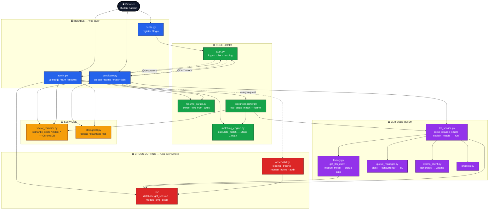
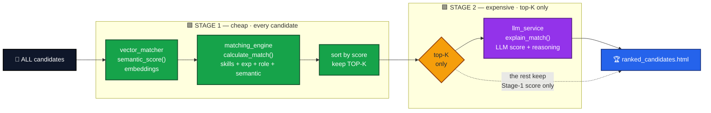
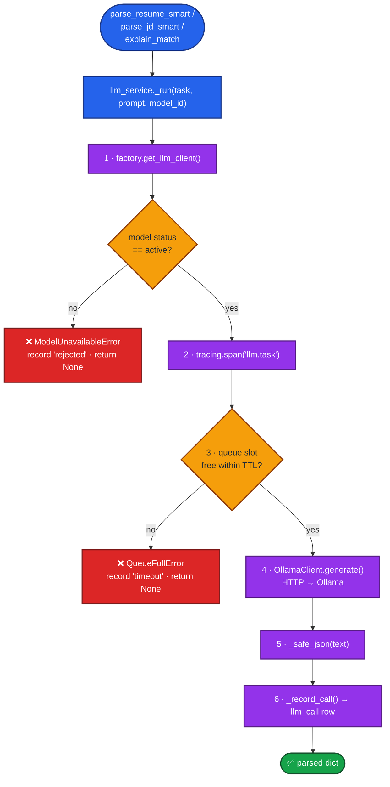

# TalentLink Portal — Architecture & "What Calls What" Guide

A student-facing map of the whole project: the layers, the files in each layer,
and — most importantly — **which function calls which function, and from where.**

Read this top to bottom once. Then use the "Call Flows" section as a lookup
whenever you're lost about where a function is invoked from.

---

## 1. The 10,000-foot view

The app is a Flask web portal. A browser hits a URL → a **route** function runs →
the route calls **service/engine** functions → those call **LLM / vector / DB**
helpers → a result goes back to an HTML template.



> Color key: 🟦 Routes (web) · 🟩 Core logic · 🟨 Services · 🟪 LLM subsystem · 🟥 Cross-cutting.
> Solid arrows = "calls". Dotted arrows = runs automatically (decorators / per-request hooks).

**Two scoring stages (remember this):**
- **Stage 1 — cheap, every candidate:** `vector_matcher.semantic_score` (embeddings)
  blended with `matching_engine.calculate_match` (keyword/experience/role math).
- **Stage 2 — expensive, top-K only:** `llm_service.explain_match` (LLM reasoning).

---

## 2. The layers and their files

| Layer | Files | Job |
|---|---|---|
| **Entry point** | `main.py` | Builds the Flask app, seeds DB, registers hooks + blueprints |
| **Config** | `config.py` | All settings/paths/env vars (read once at import) |
| **Routes (web)** | `routes/public.py`, `routes/candidate.py`, `routes/admin.py` | URL handlers; call everything else |
| **Auth** | `auth.py` | Register/login, password hashing, `@login_required` etc. |
| **Ingestion** | `resume_parser.py` | Extract raw text from PDF/DOCX/TXT (NO rules) |
| **Matching** | `matching_engine.py`, `pipeline/matcher.py` | Score a candidate vs a JD (Stage 1 + funnel) |
| **Vector** | `vector_matcher.py` | Embed + store in ChromaDB, semantic score |
| **LLM** | `llm/llm_service.py`, `llm/factory.py`, `llm/queue_manager.py`, `llm/ollama_client.py`, `llm/prompts.py`, `llm/base.py` | All LLM calls (parse resume/JD, explain match) |
| **DB** | `db/database.py`, `db/models_orm.py`, `db/seed.py` | SQLAlchemy engine, ORM tables, startup seed |
| **Observability** | `observability/logging_config.py`, `tracing.py`, `request_hooks.py`, `audit.py`, `cloudwatch.py` | Logs, trace/span ids, per-request hooks |
| **Models** | `models.py` | `Candidate`, `Admin`, `JobDescription` dataclasses |
| **Storage** | `storage/s3.py` | Upload/download resume & JD files |

---

## 3. Startup: what runs when you `python main.py`

```
python main.py
  └─ create_app()                         # main.py
       ├─ Flask(__name__)
       ├─ register jinja filters (salary, ago, iso_utc, ...)
       ├─ seed()                          # db/seed.py  → init_db() + insert models/roles
       ├─ register_request_hooks(app)     # observability/request_hooks.py
       │     └─ installs before_request / after_request on EVERY route
       ├─ app.register_blueprint(public)    # routes/public.py
       ├─ app.register_blueprint(candidate) # routes/candidate.py
       └─ app.register_blueprint(admin)     # routes/admin.py
```

After this, every incoming request automatically runs the request hooks
(trace id + logging + audit) **before and after** the route function — you never
call those yourself.

---

## 4. Call Flows — the important part

Below, each flow starts at a URL and shows the **exact function call chain**.
`A → B` means "A calls B". Indentation shows nesting.

### 4.1 Register / Login (public)

```
POST /register           routes/public.py : register()
  → auth.register_candidate()      (or auth.register_admin())
      → auth.load_json()           # read candidates.json
      → auth.hash_password()       # bcrypt
      → models.Candidate(...)      # build record
      → auth.save_json()           # write candidates.json
  → auth.set_session()             # log them in

POST /login              routes/public.py : login()
  → auth.authenticate_user()
      → auth.load_json()
      → auth.verify_password()     # bcrypt check
  → auth.set_session()
```

Who calls `auth.login_required` / `candidate_required` / `admin_required`?
→ They are **decorators** on route functions (e.g. `@login_required` above
`candidate_dashboard`). Flask runs them before the route body on every request
to that URL. You don't call them directly.

### 4.2 Candidate uploads a resume  ← most important chain

```
POST /candidate/upload-resume     routes/candidate.py : upload_resume()
  → storage.s3.resume_key()                 # build deterministic S3 key
  → storage.s3.upload_file()                # store the file
  → storage.s3.download_file()              # read it back
  → resume_parser.extract_text_from_bytes() # PDF/TXT → raw text
  → llm.llm_service.parse_resume_smart()    # raw text → {skills, exp, education}
        → llm_service._run("parse_resume", prompt, model_id)
              → llm.factory.get_llm_client(model_id)
                    → factory.resolve_model()          # DB status gate (active?)
                          → db.database.get_session()   # query model_registry
                    → returns llm.ollama_client.OllamaClient
              → observability.tracing.span("llm.parse_resume")   # start a span
              → llm.queue_manager.slot("parse_resume")           # bounded concurrency
              → OllamaClient.generate(prompt)                    # HTTP → Ollama
              → llm_service._safe_json()                         # text → dict
              → llm_service._record_call()                       # write llm_call row (DB)
  → write parsed JSON to data/parsed_resumes/<cid>.json
  → vector_matcher.index_resume(cid, raw_text)   # embed + store in ChromaDB
        → vector_matcher.embed_text()  → _get_model().encode()
        → _get_collection().upsert()
  → auth.update_candidate()                   # mark resume_uploaded=True
```

If `parse_resume_smart` can't get valid JSON it raises `LlmParseError`
(there is **no** keyword fallback — the LLM is the only parser).

### 4.3 Candidate views job matches

```
GET /candidate/match-jobs         routes/candidate.py : match_jobs()
  → _load_parsed_resume(cid)                 # read parsed_resumes/<cid>.json
  → auth.get_candidate(cid)
  → _load_all_jds()                          # read jds.json
  → for each active JD:
        → vector_matcher.semantic_score(jd_text, cid, jd_id)   # Stage-1 embeddings
              → embed_text() → _get_collection().query()
        → matching_engine.calculate_match(..., semantic_score=sem)  # blended score
              → calculate_skill_score()
              → calculate_experience_score()
              → calculate_role_relevance()
  → job_filters.build_facets() / read_selection() / filter_and_sort()
  → render_template("match_results.html", ...)
```

Note: the candidate page uses **Stage 1 only** (fast). The LLM funnel (Stage 2)
runs on the **admin** side when ranking candidates for a JD (next flow).

### 4.4 Admin ranks candidates for a JD  ← the two-stage funnel

```
GET /admin/candidates-for-jd/<jd_id>   routes/admin.py : candidates_for_jd()
  → _load_jds()                              # find target JD
  → auth.get_all_candidates()
  → pipeline.matcher.two_stage_match(jd, candidates, _load_parsed, model_id)
        STAGE 1  (span "match.stage1_shortlist", for ALL candidates):
          → load_parsed(cid)
          → vector_matcher.semantic_score()
          → matching_engine.calculate_match(..., semantic_score=sem)
          → sort by overall_score, keep top_k
        STAGE 2  (span "match.stage2_llm", top-K ONLY):
          → llm.llm_service.explain_match(resume_text, jd_text, model_id)
                → _run("explain_match", ...)   # same gated/queued/logged path as 4.2
  → render_template("ranked_candidates.html", ranked=...)
```

`model_id` comes from `session["selected_model"]` (the admin model picker).



> Why a funnel? Embeddings + math are cheap, so we score **everyone** in Stage 1.
> The LLM is slow/costly, so it only runs on the **top-K** finalists in Stage 2.

### 4.5 Admin uploads / edits / toggles a JD

```
POST /admin/upload-jd       routes/admin.py : upload_jd()
  → storage.s3.jd_key() / upload_file() / download_file()   (if a file given)
  → resume_parser.extract_text_from_bytes()                 (if a file given)
  → salary.parse_salary_form()
  → models.JobDescription(...).to_dict()
  → _save_jds()                              # write jds.json
  → vector_matcher.index_jd(jd_id, jd_text)  # embed JD into ChromaDB
  → _audit.info("jd.uploaded", ...)          # audit log line

POST /admin/jds/<id>/delete        → delete_jd()      → vector_matcher.delete_jd()
POST /admin/jds/<id>/reactivate    → reactivate_jd()  → vector_matcher.index_jd()
POST /admin/jds/<id>/edit          → edit_jd()        → vector_matcher.index_jd()
```

### 4.6 Admin model registry (Stage 4 UI)

```
GET  /admin/models                 → models()            → db query model_registry
POST /admin/models/select          → select_model()      → session["selected_model"]=...
POST /admin/models/<id>/status     → set_model_status()  → update model_registry.status
```

The status set here is exactly what `factory.resolve_model` checks in 4.2/4.4 —
set a model to `inactive` and every LLM call using it is rejected.

---

## 5. The LLM sub-system (zoom in)

Every LLM feature funnels through **one** function: `llm_service._run()`.
Understand this and you understand all three public calls
(`parse_resume_smart`, `parse_jd_smart`, `explain_match`).

```
llm_service._run(task, prompt, model_id)
   │
   ├─ 1. factory.get_llm_client(model_id)
   │        └─ resolve_model()  ── DB ──▶  is this model 'active'?  (gate)
   │        └─ returns OllamaClient
   │
   ├─ 2. tracing.span("llm.<task>")      ── wraps the call in a span_id
   │
   ├─ 3. queue_manager.slot(task)        ── at most N concurrent LLM calls;
   │                                        raises QueueFullError after TTL
   │
   ├─ 4. OllamaClient.generate(prompt)   ── HTTP POST to local Ollama
   │
   ├─ 5. _safe_json(text)                ── pull the JSON object out of the reply
   │
   └─ 6. _record_call(...)               ── INSERT a row into llm_call (DB)
```



> Every LLM feature takes this exact path. The two 🟠 diamonds are the guards:
> an **inactive model** or a **full queue** short-circuits to a 🔴 failure that is
> logged and returns `None` (callers then fall back to the non-LLM score).

Prompts come from `llm/prompts.py` (`build_resume_parse_prompt`, etc.).
`LLMClient` (in `llm/base.py`) is the abstract base; `OllamaClient` is the only
implementation today, so swapping providers later means adding one class.

---

## 6. Cross-cutting: things that run without being called from routes

These are easy to miss because **no route calls them explicitly** — they're wired
once at startup and then fire automatically.

- **Request hooks** (`observability/request_hooks.py`): registered in
  `main.create_app()`. Flask runs `before_request` / `after_request` on **every**
  request → sets a fresh `trace_id`, logs the request, and audits every
  POST/PUT/DELETE into a `request_trace` DB row.
- **Tracing** (`observability/tracing.py`): `get_trace_id()` / `get_span_id()` are
  read inside `llm_service._record_call()` so every `llm_call` row is tied to the
  web request that caused it.
- **Logging** (`observability/logging_config.py`): `get_logger("name")` is called
  all over (routes, matcher, llm_service) to emit JSON logs to `logs/app.jsonl`.
- **DB session** (`db/database.py`): `get_session()` is the one context manager used
  by the factory, llm_service, and admin model routes to talk to Postgres/SQLite.

---

## 7. "Where is this called from?" quick index

| Function | Lives in | Called by |
|---|---|---|
| `calculate_match` | `matching_engine.py` | `routes/candidate.py` (match_jobs, match_detail), `pipeline/matcher.py` |
| `calculate_skill_score` / `_experience_score` / `_role_relevance` | `matching_engine.py` | `calculate_match` (same file) |
| `semantic_score` | `vector_matcher.py` | `routes/candidate.py`, `pipeline/matcher.py` |
| `index_resume` | `vector_matcher.py` | `routes/candidate.py : upload_resume` |
| `index_jd` / `delete_jd` | `vector_matcher.py` | `routes/admin.py` (upload/edit/delete/reactivate) |
| `two_stage_match` | `pipeline/matcher.py` | `routes/admin.py : candidates_for_jd` |
| `parse_resume_smart` | `llm/llm_service.py` | `routes/candidate.py : upload_resume` |
| `explain_match` | `llm/llm_service.py` | `pipeline/matcher.py` (Stage 2) |
| `_run` | `llm/llm_service.py` | the 3 public llm_service funcs (same file) |
| `get_llm_client` | `llm/factory.py` | `llm_service._run` |
| `resolve_model` | `llm/factory.py` | `factory.get_llm_client` |
| `slot` | `llm/queue_manager.py` | `llm_service._run` |
| `OllamaClient.generate` | `llm/ollama_client.py` | `llm_service._run` |
| `get_session` | `db/database.py` | factory, llm_service, admin model routes, request_hooks |
| `register_candidate` / `authenticate_user` | `auth.py` | `routes/public.py` |
| `login_required` / `candidate_required` / `admin_required` | `auth.py` | decorators on route functions |
| `extract_text_from_bytes` | `resume_parser.py` | `routes/candidate.py`, `routes/admin.py` |
| `seed` | `db/seed.py` | `main.create_app` |
| `register_request_hooks` | `observability/request_hooks.py` | `main.create_app` |

---

## 8. How to use this when you're stuck

1. **Start from the URL** you hit in the browser → find it in Section 4.
2. Follow the `→` arrows down to see every function that runs for that request.
3. To go the other way ("who calls X?"), use the Section 7 table.
4. If a function seems to run "by magic", check Section 6 (cross-cutting hooks).

See the companion visual diagrams rendered in the chat for the same flows.
